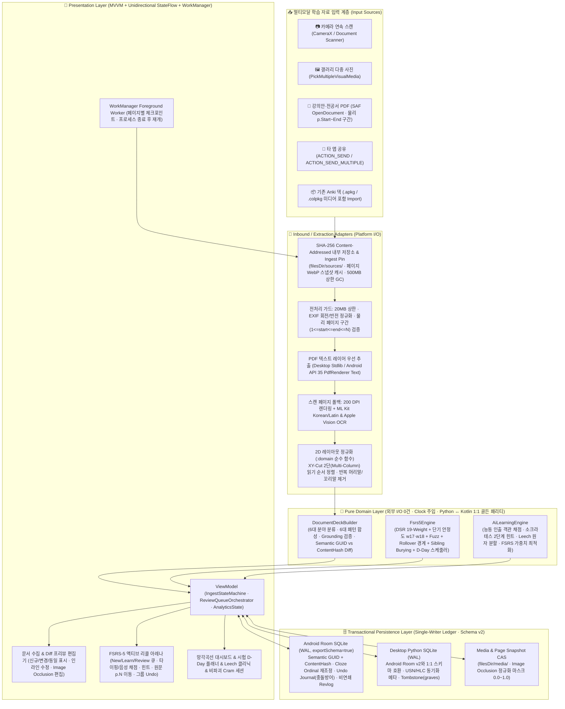

# 🏛️ Anki Studio 2.0 — 마스터 소프트웨어 설계도 & 전체 기능 정의서 (Master Architecture & Feature Blueprint)

- **문서 번호**: `ANKI-BLUEPRINT-2026-10-20` (**v1.3 Final** — Claude Opus 5.5 Tech Lead 설계 + Codex GPT-6.1 Sol 2차 정밀 검증 통합본)
- **프로젝트 경로**: `/Users/choyoungseo/Documents/개발/Anki-Studio` (`src/anki_studio` + `android-app/`)
- **아키텍처 표준**: Clean / Hexagonal Architecture + MVVM + State Machine + ATDD/BDD/TDD/DDT
- **설계 목적**: 본격적인 기능 확장 및 상용 수준 고도화 전에 **전체 필수 기능(What to Build)**과 **아키텍처·데이터·예외 처리 경계(How to Build Without Rework)**를 정밀하게 정의하여 구현 후 재작업(삽질)을 원천 차단한다.

---

## 1. 시스템 전체 아키텍처 토폴로지 (Clean / Hexagonal + Multi-Platform Parity)



---

## 2. 구현 후 '삽질(재작업)'을 유발하는 15대 아키텍처 함정과 선제 방어 설계

구현 중반 이후에 발견하면 DB 스키마를 갈아엎거나 UI/도메인 전체를 다시 짜야 하는 **15가지 핵심 기술 함정(Architectural Traps)**을 코드 대조, Claude Opus 5.5 Tech Lead 설계, Codex GPT-6.1 Sol 독립 리뷰를 통해 전수 식별하고 해결책을 설계도에 고정했습니다.

| # | 재작업 위험 포인트 (Trap) | 현재 코드 진단 (`commit 3387f9b` 기준) | 선제 방어 설계 (Blueprint v1.2 Solution) |
| :-: | :--- | :--- | :--- |
| **T1** | **Room 마이그레이션 불가 및 스키마 확장성 부재** | `AnkiStudioDatabase.kt`가 `version = 1, exportSchema = false`이며 노트가 `front/back` 고정 컬럼이라 Image Occlusion·어학 역방향·`.apkg` 왕복 호환 시 테이블 재작성 필요 | **`exportSchema = true` + 유연한 필드/미디어 스키마**: `room.schemaLocation` 활성화, `MigrationTestHelper` 의무화, `fields_json` 확장 컬럼 및 `media_files`·`graves`·`study_sessions` 테이블 선반영 |
| **T2** | **카드 삭제 시 `revlog` 연쇄 삭제로 인한 학습 통계·FSRS 최적화 데이터 증발** | `RevlogEntity`의 `ForeignKey(onDelete = CASCADE)`로 인해 카드를 삭제하면 과거 복습 기록까지 함께 삭제됨 | **`revlog` 비연쇄(Non-Cascading) 영구 보존**: `revlog`에서 `CASCADE` 외래키를 제거하여 카드가 삭제/분할되더라도 사용자의 장기 기억 데이터(스트릭 히트맵, FSRS `w0~w18` 개인화 학습용 표본)는 영구 보존 |
| **T3** | **그룹 Undo 불가 · 편집 충돌 · 동기화 부활 버그** | `RevlogEntity`에 직전 상태 일부만 있고, 형제 카드 Bury 복원이나 Undo 후 동기화 시 삭제된 `revlog`가 되살아나는 문제가 있음 | **Revision 검증형 `undo_journal` + Tombstone 연동**:<br>① 복습 1회 시 본 카드 + 형제 Bury 카드들의 직전 스냅샷과 `after_modified_at_ms`를 `undo_journal`에 저장<br>② 이후 카드 편집/동기화로 `modified_at_ms`가 달라진 경우 Undo 차단(`undo_conflict`)<br>③ 최근 `30그룹`만 유지(만료 시 `undo_journal`만 정리, `revlog`는 유지)<br>④ 실제 Undo 실행 시에만 `revlog`를 삭제하고 `graves`에 tombstone 기록 |
| **T4** | **신규 카드(`new`)에서 `Again` 선택 시 `lapses`가 증가하는 FSRS-5 수식 버그** | `Fsrs5Engine.kt`(`L141`)와 `fsrs_math.py`에서 `isNew`일 때 `AGAIN`을 누르면 `lapses += 1`이 되어, 처음 보는 카드를 두 번만 틀려도 거머리 카드(`lapses >= 2`)로 오판함 | **FSRS 표준 Lapse 불변식 교정**: `lapses`는 오직 **`state == "review"`(장기 복습 단계)에서 잊어버렸을(`AGAIN`) 때만 `+1` 증가**하도록 수정. 또한 FSRS-5 당일 단기 안정도 수식(`w17`, `w18`)과 간격 Fuzz 반영 |
| **T5** | **하루 경계 시각(Day Rollover) 부재 및 큐(`queue`) 코드 불일치** | `getDueCards`가 `dueEpochSec <= now` 조건 하나로 모든 카드를 섞어 가져오며, `elapsedDays`를 초 단위 실수로 계산함 | **Rollover 기준 학습일(`studyDay`, 기본 `04:00 AM`) & 7-State `queue` 코드 통일**:<br>`0:NEW`, `1:INTRADAY_LEARNING`(초 단위 due), `2:REVIEW`(일 단위 due), `3:INTERDAY_LEARNING`(일 단위 due), `-1:SUSPENDED`, `-2:USER_BURIED`, `-3:SIBLING_BURIED`로 전 계층 통일 및 일일 한도 적용 |
| **T6** | **동일 문장 다중 빈칸(`c1`, `c2`) 및 역방향 카드 당일 연속 출제 스포일러** | 한 노트의 `{{c1::A}}`와 `{{c2::B}}` 카드가 같은 날 연달아 나와 앞 카드가 뒤 카드의 정답을 노출함 | **Sibling Burying (`queue = -3`, `buried_until_study_day = today + 1`)**: 특정 `noteId`의 카드를 복습하면 동일 `noteId`의 다른 미복습 카드를 다음 학습일(새벽 4시)까지 자동 숨김 처리 |
| **T7** | **모바일 카메라 촬영본 EXIF 회전 무시로 인한 한글 OCR 붕괴** | `decodeSampledBitmap`이 `BitmapFactory`만 사용해 EXIF `ORIENTATION_ROTATE_90`을 무시하고 `InputImage.fromBitmap(bitmap, 0)`으로 넘겨 세로 사진이 90° 누운 채 OCR됨 | **EXIF 회전/반전 정규화 필수화**: `ExifInterface`로 회전각과 좌우 반전(Flip)을 읽어 정방향 비트맵으로 정규화한 뒤 OCR 및 Image Occlusion 좌표계(0.0~1.0)의 기준 이미지로 사용 |
| **T8** | **2단(Two-Column) PDF 좌우 줄 섞임 및 디지털 PDF 무조건 OCR 처리 병목** | 2단 논문/법전/시험지에서 좌우 컬럼 줄이 섞여 문장이 깨지며, 텍스트 레이어가 있는 디지털 PDF까지 무조건 200 DPI 비트맵 OCR을 돌려 속도가 10배 느려짐 | **텍스트 레이어 우선 추출 + `:domain` 순수 XY-Cut 2단 정렬기**: 디지털 PDF는 텍스트 레이어를 우선 추출(실패 페이지만 200 DPI OCR 폴백)하고, 2D `boundingBox` 기반 **XY-Cut 컬럼 분할 정렬**을 `:domain` 순수 함수로 구현해 Python·Kotlin 골든 픽스처로 검증 |
| **T9** | **페이지 구간(`p.Start~End`) 선택 시 물리 페이지 번호와 상대 인덱스 혼동** | 300쪽 PDF에서 `101~150쪽`만 수집할 때 `source_page`가 `1..50`으로 저장되면 원문 페이지 이동 시 엉뚱한 페이지가 열림 | **물리 페이지 번호(`source_page`) 절대 좌표계 고정**: `source_page`는 항상 **원본 PDF의 1-based 물리 페이지 번호(`101..150`)**로 기록(`PdfRenderer` 인덱스는 `source_page - 1`)하고, 책에 인쇄된 쪽번호는 별도 `page_label`로 분리. 범위는 `1 <= start <= end <= page_count` 및 `end - start + 1 <= 50`으로 검증 |
| **T10** | **프리뷰 취소 시 CAS 임시 파일 누수 및 대형 PDF 저장소 용량 폭발** | `filesDir/sources/<sha256>`에 20MB PDF를 계속 복사하거나 프리뷰만 보고 취소하면 고아 파일이 쌓임 | **Ingest Pin 수명주기 + 페이지 WebP 스냅샷 캐시 + 500MB GC**:<br>① 수집 중에는 `ingest_pins(sha256, expires_at)`로 임시 핀 고정<br>② 프리뷰 취소 시 무참조+핀 만료 파일을 GC가 자동 정리<br>③ 카드가 실제 참조하는 페이지만 고압축 WebP 스냅샷(`~80KB/쪽`)으로 영구 보관하고 원본 대용량 PDF는 총 캐시 상한(`500MB`) 초과 시 LRU 정리 가능하도록 분리 |
| **T11** | **문서 개정/문구 수정 시 `guid` 변경으로 인한 `UPDATED` 매칭 실패** | `guid`에 `docSha256`과 전체 `front`를 넣으면 개정판 PDF나 오타 수정본 투입 시 `guid`가 달라져 기존 카드를 갱신하지 못하고 신규 카드로 중복 생성함 | **`semantic_guid` (노트 정체성)와 `content_hash` (내용 해시) 분리**:<br>① `semantic_guid = sha256(deckId || noteType || pattern || anchorKey)[:16]` (예: 조문번호 `민법_제103조`, 정의 용어 `gaa트랜지스터`)<br>② `content_hash = sha256(normalizedFront || "\0" || normalizedBack || "\0" || canonicalFieldsJson)` (마스크 좌표 변경까지 감지)<br>③ 재투입 시 `semantic_guid`가 같고 `content_hash`만 다르면 **`UPDATED`**로 판정하여 텍스트/필드만 갱신하고 FSRS 학습 이력은 100% 유지! |
| **T12** | **노트 생성/수정 시 희소 Cloze 번호(`c1, c3`) 및 빈칸 변경에 따른 자식 카드 고아/누락** | 신규 노트가 `c1, c3`일 때 `1..k`로 생성하거나 수정 시 사라진 `ord=2` 카드와 새로 생긴 `ord=3` 카드의 처리 규칙이 없음 | **Distinct Cloze Ordinal 원자적 재조정 규칙**:<br>① 신규 생성 및 수정 모두 `1..k` 연속 가정 대신 실제 추출된 고유 번호 집합 `distinctOrdinals(front)`(예: `{1, 3}`)를 사용<br>② 유지된 `ord`(`c1`): 기존 `card_id` 및 FSRS 상태 완벽 유지<br>③ 추가된 `ord`(`c3`): 신규 `CardEntity(state='new', queue=0)` 생성<br>④ 제거된 `ord`(`c2`): `reps == 0`(미학습)이면 즉시 삭제, `reps > 0`(학습 이력 존재)이면 이력 보호를 위해 삭제하지 않고 `queue = -1(SUSPENDED)` 처리 |
| **T13** | **Filtered / Cram 커스텀 덱 사용 시 `deck_id` 직접 변경으로 인한 원복 실패** | 시험 직전 오답 카드를 임시 덱으로 옮기면서 `cards.deck_id`를 덮어쓰면 크래시나 덱 삭제 시 원래 소속 덱과 스케줄이 깨짐 | **비파괴 가상 세션 테이블 (`study_sessions` + `study_session_items`)**: `cards.deck_id`는 절대 변경하지 않고 세션 헤더 `study_sessions(session_id, name, filter_query, reschedule_enabled)`와 멤버십 `study_session_items(session_id, card_id, position, completed)`로 참조만 연결. 연습 모드(`study_sessions.reschedule_enabled=0`)는 FSRS 상태를 건드리지 않으며, 세션 종료/삭제 시 카드를 이동할 필요 자체가 없음 |
| **T14** | **백그라운드 프로세스 종료 시 작업 증발** | `viewModelScope`에서 OCR이 돌아 앱 전환 시 중단됨 | **`WorkManager` Foreground 체크포인트**: 페이지별 추출 결과를 로컬 스테이징에 체크포인트로 남겨 프로세스 재시작 시 마지막 완료 페이지 다음부터 재개 |
| **T15** | **Desktop(Python) ↔ Android(Kotlin) 도메인/스키마 이중 구현 괴리** | Python에만 `ai_learning.py`와 `plan_backlog_decompression`이 있고 Android `:domain`에는 빠져 있음 | **`:domain` 100% 패리티 & CI Golden Vector Gate**: `AiLearningEngine.kt`와 `planBacklogDecompression`을 `:domain`에 완전 이식하고, `tests/fixtures/`의 공용 JSON 골든 벡터로 Python·Kotlin 출력이 바이트 단위로 일치함을 강제 |

---

## 3. 학습 분야별·공통 필수 기능 정의서 (Comprehensive Feature Matrix: FD-1 ~ FD-7)

실제 학습자(의학·법학·공학·어학·자격증·일반 전공)가 학습 전 과정에서 겪는 불편을 해소하기 위한 **7대 기능 도메인(FD-1 ~ FD-7)** 상세 명세입니다.

### FD-1. 멀티모달 문서·사진 수집 & 비전 파이프라인 (Ingestion & Vision Pipeline)
- **FD-1.1 5대 입력 채널**:
  1. **카메라 문서 스캐너**: 연속 촬영 + 원근/기울기 보정(`GmsDocumentScanning` / `CameraX`)
  2. **갤러리 다중 사진 일괄 선택 (`PickMultipleVisualMedia`)**: 최대 20장 필기/교재 사진 일괄 투입
  3. **PDF 문서 & 물리 페이지 구간 선택기 (`OpenDocument` + Physical Page Range Selector)**: 500쪽 대형 교재도 `1 <= startPage <= endPage <= pageCount` (`endPage - startPage + 1 <= 50`) 구간을 지정해 단원별 덱 생성 (`source_page`는 항상 원본 물리 페이지 번호로 보존)
  4. **시스템 멀티 공유 인텐트 (`ACTION_SEND` + `ACTION_SEND_MULTIPLE`)**: 굿노트·삼성노트·카카오톡·파일 앱에서 사진 여러 장이나 PDF를 즉시 Anki Studio로 공유
  5. **표준 `.apkg` / `.colpkg` 임포트**: 기존 Anki 공유 덱(미디어 파일 포함) 무손실 가져오기
- **FD-1.2 EXIF 정규화 & 하이브리드 PDF 추출**:
  - 이미지: `ExifInterface` 회전/반전 정규화 ➔ `MAX_PAGE_DIMENSION_PX = 2200` 다운샘플링 ➔ ML Kit Korean+Latin OCR
  - PDF: 페이지별 디지털 텍스트 레이어 우선 추출 ➔ 텍스트가 없거나 깨진 스캔 페이지만 200 DPI 비트맵 렌더링 후 OCR 폴백
- **FD-1.3 2D XY-Cut 다단(Multi-Column) 읽기 순서 정렬 & 헤더/푸터 제거**:
  - 2단 논문/기출문제지의 세로 여백(Gutter)을 감지하여 좌측 단 위→아래 완독 후 우측 단 위→아래 순서로 블록 정렬
  - 3페이지 이상 동일 텍스트 또는 상하단 극단 영역(상단 7%, 하단 7%)에 반복 출현하는 머리말·꼬리말·쪽번호 자동 제거(인쇄 쪽번호는 `page_label`로만 별도 보관)
- **FD-1.4 `WorkManager` 백그라운드 수집 & 페이지별 진행률/취소**:
  - `EXTRACTING(currentPage, totalPages)` 실시간 진행률 표시, 중간 취소(`cancelIngest`), 앱 백그라운드 전환 시에도 페이지 체크포인트 기반 무중단 처리

### FD-2. 지능형 덱 합성 · Grounding 검증 · 멱등 Upsert (Deck Synthesis & Grounding)
- **FD-2.1 6대 학습 분야 자동 감지 & 계층형 덱/태그**:
  - `law`(법학·행정), `medical`(의학·간호), `engineering`(공학·IT), `language`(어학·회화), `exam`(자격증·수험), `general`(일반 전공)
  - 계층형 덱 이름(`의학::해부학::순환기`) 및 계층형 태그(`#법학::민법::물권`) 지원
- **FD-2.2 6대 학습 카드 패턴 + 양방향(Reversed) 카드**:
  1. `definition` (`용어: 설명`, `~란 ~이다`) ➔ 핵심 개념 Cloze (옵션: 용어↔정의 양방향 카드 생성)
  2. `numbered_list` (`①②③`, `1) 2) 3)`) ➔ 항목 열거 다중 Cloze (`c1, c2, c3`)
  3. `causal_compare` (`때문에`, `반면`, `vs`, `→`, `whereas`) ➔ 인과·비교 Q&A
  4. `statute_numeric` (`제N조`, `3nm`, `120mmHg`, `3년 이하`) ➔ 조문·수치·단위 Cloze
  5. `language_pair` (`표현 -> 뜻/교정`, 예문) ➔ Speaking / 양방향 어학 카드 (`ord=1` 한→영 발화, `ord=2` 영→한 의미)
  6. `image_occlusion` (해부도·회로도·표 이미지 위 OCR 박스 마스킹) ➔ 정규화 좌표(`0.0~1.0`) 기반 이미지 가리기 카드 (`Hide One Guess One` / `Hide All Guess One`)
- **FD-2.3 100% 원문 Grounding 검증 & 수식 보존**:
  - 모든 카드의 정답 핵심 토큰과 모든 숫자가 `source_page` 원문에 실재하는지 검증 (`droppedUngrounded` 집계, 환각 원천 차단)
  - 공학/수학 수식(`$...$`, `$$...$$`, 그리스 문자, 첨자)이 정규화 과정에서 유실되지 않도록 보존
- **FD-2.4 `semantic_guid` + `content_hash` 기반 스마트 Upsert & Cloze 재조정 (`신규 N / 변경 M / 동일 K`)**:
  - 동일 문서를 다시 넣거나 개정판 PDF를 넣으면 `신규 카드 N장 / 내용 갱신 M장(FSRS 복습 이력 유지 + Cloze ordinal 안전 재조정) / 변경 없음 K장`을 분류해 프리뷰로 제시

### FD-3. FSRS-5 스케줄러 & 3-Queue 복습 오케스트레이터 (FSRS-5 & Queue Engine)
- **FD-3.1 FSRS-5 완전 수식 구현 (`w0~w18`)**:
  - 멱함수 망각곡선 $R(t, S) = (1 + \frac{19}{81}\frac{t}{S})^{-0.5}$
  - 난이도 평균 회귀 $D'$ + 회상 성공 안정도 증폭 $S'_r$ + 망각 시 감쇠 $S'_f$ + **당일 단기 학습 안정도 갱신($w_{17}, w_{18}$)** + **복습 집중 방지 간격 Fuzz($\pm 5\%$ 결정론적 시드 분산)**
  - **Lapse 정확성 불변식**: `state == "review"` 카드에서 `AGAIN`을 누른 경우에만 `lapses += 1`
- **FD-3.2 학습일 경계(`rolloverHour = 4`) & 3-Queue 분리 (`New` / `Learning` / `Review`)**:
  - 새벽 4시(`decks.rollover_hour`)를 기준으로 학습일(`studyDay`) 전환
  - **큐 우선순위**: ① `INTRADAY_LEARNING (queue=1)`(`due_epoch_sec <= now`) ➔ ② `INTERDAY_LEARNING (queue=3) & REVIEW (queue=2)`(`due_study_day <= today`, `dailyReviewLimit` 한도) ➔ ③ `NEW (queue=0)`(`dailyNewLimit` 한도)
- **FD-3.3 형제 카드 자동 묻기 (Sibling Burying)**:
  - 같은 `noteId`에서 파생된 Cloze(`c1..cN`)나 역방향 카드(`ord=1,2`) 중 하나를 복습하면 나머지 형제 카드는 `queue = -3 (SIBLING_BURIED)`, `buried_until_study_day = today + 1`로 설정하여 당일 스포일러 차단 (하루 경계 경과 시 자동 해제)
- **FD-3.4 Revision 검증형 그룹 Undo (`undoLastReview`)**:
  - 직전 복습 1회가 변경한 본 카드 + 형제 카드들의 상태를 `undo_journal`로부터 단일 트랜잭션으로 완벽 복원하고, 방금 기록된 `revlog`를 제거하며 `graves`에 tombstone 기록
- **FD-3.5 복습 폭탄 평탄화 (`Smart Backlog Decompressor`) & 시험일(`D-Day`) 모드**:
  - 밀린 복습 카드를 인출확률 $R(t,S)$ 위험도 순으로 `horizonDays`에 평탄화 분산
  - **시험 D-Day 모드**: 특정 덱에 시험일(`exam_target_study_day`) 설정 시 시험 전날까지 목표 기억률을 `0.95`로 끌어올리도록 간격 상한 조정

### FD-4. AI 능동 인출(Active Recall) & 메타인지 튜터 (AI Active Recall Tutor)
- **FD-4.1 객관적 능동 인출 채점기 (`evaluateFreeRecall` — Desktop & Android `:domain` 공통)**:
  - 정답 확인 전 사용자가 타이핑 또는 음성(STT)으로 답변을 입력하면 의미 토큰(65%) + 바이그램(35%) + 수치/단위 일치 + 부정어 충돌을 분석해 **0~100% 점수와 추천 등급(`Again/Hard/Good/Easy`) 제시**
- **FD-4.2 소크라테스 2단계 힌트 (`generateSocraticHint` — Desktop & Android `:domain` 공통)**:
  - `Level 1`: 첫 글자 + 글자 수 + 핵심 수치/개념 유도 질문
  - `Level 2`: 단어 구조 마스킹 + 앞글자 연상 코드(Acronym Mnemonic)
- **FD-4.3 거머리 카드(Leech) 원자 분할기 (`decomposeLeechCard` — Desktop & Android `:domain` 공통)**:
  - `lapses >= 2` 반복 오답 카드를 감지해 2~4개의 단일 개념 마이크로 Cloze 카드로 분할 저장하고 원본 카드는 `queue = -1 (SUSPENDED)` 처리 (원본의 과거 `revlog`는 삭제하지 않고 보존)
- **FD-4.4 멀티모달 TTS 발음 & STT 구술 인출**:
  - Android `TextToSpeech` / Desktop Web Speech를 통한 한·영 자동 발음 재생 및 음성 답변 입력

### FD-5. 원문 추적성 뷰어 & 비파괴 커스텀 학습 세션 (Source Traceability & Cram Session)
- **FD-5.1 원문 페이지 즉시 열람 (Jump-to-Source `p.N` Viewer)**:
  - 복습 카드나 프리뷰에서 `📄 출처: 파일명 (p.114)` 배지를 누르면 페이지 스냅샷(`filesDir/page_snapshots/<doc_sha256>_p114.webp` 또는 원본 PDF 물리 114페이지)을 즉시 모달로 렌더링하고 발췌 문맥(`sourceExcerpt`) 하이라이트 표시
- **FD-5.2 통합 카드 브라우저 & 비파괴 Filtered / Cram 세션 (`study_sessions`)**:
  - 검색어, 카테고리, 태그(`#law`, `#leech`), 상태(`new`, `review`, `suspended`, `buried`), 플래그(`flag 1~4`)로 필터링
  - 시험 직전 `"오늘 틀린 카드만"`, `"수치/조문 카드만"` 모아 학습하는 **비파괴 Cram 세션** 지원 (`cards.deck_id`를 변경하지 않고 가상 세션 멤버십으로 동작, 연습 모드/실제 스케줄 반영 모드 선택 가능)

### FD-6. 분야별 특화 학습 도구 (Domain-Specific Power Features)
- **의학/간호**: 해부도·조직 사진 **Image Occlusion 편집기/렌더러** (OCR 텍스트 박스 자동 감지 → 원터치 마스크 생성)
- **법학/행정**: 조문(`제N조 제M항`) 시맨틱 앵커 파싱 + **법령/교재 개정본 PDF 재투입 시 복습 이력 유지형 스마트 갱신**
- **공학/IT**: 수식(`LaTeX`) 및 코드 스니펫 가독성 렌더링 + 단위(`nm`, `GHz`, `mmHg`, `dB`) 불일치 시 엄격 감점
- **어학/회화**: `표현 -> 원어민 교정` 스피킹 카드 + 원어민 TTS + 역방향 카드 자동 쌍 생성

### FD-7. `.apkg` 무손실 호환 · 백업 · 동기화 (Interoperability, Backup & Sync)
- **FD-7.1 미디어 포함 `.apkg` / `.colpkg` 양방향 코덱**:
  - 텍스트 노트뿐 아니라 Image Occlusion 이미지 및 오디오(`media` 매핑 파일)까지 포함하여 기존 Anki 생태계와 왕복 호환
- **FD-7.2 안전한 로컬 백업 & 동기화 기반 메타데이터**:
  - Android `dataExtractionRules`로 불완전한 WAL 클라우드 자동 백업 손상을 방지하고, 명시적 스냅샷 백업 제공
  - 모든 엔티티에 `sync_id (ULID/UUID)`, `modified_at_epoch_ms`, `usn` 및 삭제 `graves(tombstone)`를 두어 Desktop ↔ Android 간 증분 동기화(LWW + `revlog` 합집합) 지원

---

## 4. 정규화된 데이터베이스 스키마 v2 설계 (Room & Python SQLite 공통 정본)

`exportSchema = true`로 관리되며, Desktop(`sqlite_store.py`)과 Android(`AnkiStudioDatabase.kt`)가 동일한 논리 모델을 공유합니다.

```sql
-- 1. 원본 문서 Content-Addressed 원장 (임시 URI 만료 방지 및 문서 계보/재수집 추적)
CREATE TABLE source_documents (
    doc_id INTEGER PRIMARY KEY AUTOINCREMENT,
    sha256_hash TEXT NOT NULL UNIQUE,          -- 원본 파일 바이트 SHA-256
    doc_lineage_key TEXT NOT NULL,             -- 문서 계열 식별자 (개정판 연결용, 기본: 정규화된 문서 제목)
    filename TEXT NOT NULL,
    mime_type TEXT NOT NULL,
    page_count INTEGER NOT NULL,
    local_cas_path TEXT,                       -- filesDir/sources/<sha256> (용량 초과 GC 시 null 가능, 스냅샷은 유지)
    extractor_version INTEGER NOT NULL DEFAULT 1,
    imported_at_epoch_sec INTEGER NOT NULL
);

-- 2. 수집 작업 임시 Pin (프리뷰 중 GC 오삭제 방지 및 취소 시 고아 파일 정리)
CREATE TABLE ingest_pins (
    pin_id TEXT PRIMARY KEY,                   -- ingest_session_id
    sha256_hash TEXT NOT NULL,
    expires_at_epoch_sec INTEGER NOT NULL
);

-- 3. 미디어 & 페이지 스냅샷 Content-Addressed 저장소 (Image Occlusion · 페이지 WebP 캐시 · 오디오)
CREATE TABLE media_files (
    sha256_hash TEXT PRIMARY KEY,
    media_kind TEXT NOT NULL DEFAULT 'asset',  -- 'asset' | 'page_snapshot' | 'occlusion_base'
    mime_type TEXT NOT NULL,
    local_path TEXT NOT NULL,                  -- filesDir/media/<sha256>
    byte_size INTEGER NOT NULL,
    last_accessed_epoch_sec INTEGER NOT NULL,
    created_at_epoch_sec INTEGER NOT NULL
);

-- 4. 덱 및 스케줄러 설정 (계층형 덱, 일일 한도, 학습일 경계 시각, 시험일 D-Day 포함)
CREATE TABLE decks (
    id INTEGER PRIMARY KEY AUTOINCREMENT,
    sync_id TEXT NOT NULL UNIQUE,              -- ULID/UUID (Desktop↔Android 동기화 식별자)
    parent_id INTEGER REFERENCES decks(id) ON DELETE SET NULL,
    name TEXT NOT NULL UNIQUE,                 -- 예: '의학::해부학::순환기'
    description TEXT NOT NULL DEFAULT '',
    category TEXT NOT NULL DEFAULT 'general',  -- law | medical | engineering | language | exam | general
    desired_retention REAL NOT NULL DEFAULT 0.90,
    daily_new_limit INTEGER NOT NULL DEFAULT 20,
    daily_review_limit INTEGER NOT NULL DEFAULT 100,
    rollover_hour INTEGER NOT NULL DEFAULT 4,  -- 하루 경계 시각 (기본 04:00 AM)
    learning_steps_sec_json TEXT NOT NULL DEFAULT '[60, 600]',
    relearning_steps_sec_json TEXT NOT NULL DEFAULT '[600]',
    fsrs_weights_json TEXT,                    -- null이면 DEFAULT_FSRS5_WEIGHTS(19개) 사용
    exam_target_study_day INTEGER,             -- 시험 D-Day 학습일 (설정 시 목표 기억률 부스트)
    modified_at_epoch_ms INTEGER NOT NULL,
    created_at_epoch_sec INTEGER NOT NULL
);

-- 5. 노트 (semantic_guid 정체성 + content_hash 변경 감지 분리)
CREATE TABLE notes (
    id INTEGER PRIMARY KEY AUTOINCREMENT,
    guid TEXT NOT NULL UNIQUE,                 -- semantic_guid: sha256(deckId || noteType || pattern || anchorKey)[:16]
    content_hash TEXT NOT NULL,                -- sha256(normalizedFront || "\0" || normalizedBack || "\0" || canonicalFieldsJson)
    deck_id INTEGER NOT NULL REFERENCES decks(id) ON DELETE CASCADE,
    doc_id INTEGER REFERENCES source_documents(doc_id) ON DELETE SET NULL,
    note_type TEXT NOT NULL,                   -- basic | basic_reversed | cloze | speaking | image_occlusion
    front TEXT NOT NULL,
    back TEXT NOT NULL,
    fields_json TEXT NOT NULL DEFAULT '{}',    -- 다중 필드 & Image Occlusion 마스크 정규화 좌표(0.0~1.0) JSON
    extra_context TEXT NOT NULL DEFAULT '',
    tags_csv TEXT NOT NULL DEFAULT '',
    marked INTEGER NOT NULL DEFAULT 0,
    source_filename TEXT NOT NULL DEFAULT '',
    source_page INTEGER NOT NULL DEFAULT 1,    -- 항상 원본 문서의 1-based 물리 페이지 번호 (1..page_count)
    page_label TEXT,                           -- 인쇄된 쪽번호 텍스트 (별도 보존)
    source_excerpt TEXT NOT NULL DEFAULT '',
    page_snapshot_sha256 TEXT REFERENCES media_files(sha256_hash) ON DELETE SET NULL,
    media_sha256 TEXT REFERENCES media_files(sha256_hash) ON DELETE SET NULL,
    modified_at_epoch_ms INTEGER NOT NULL,
    created_at_epoch_sec INTEGER NOT NULL
);

-- 6. 카드 (7-State Queue 코드 통일, Sibling/Manual Burying, Suspend, Flag 완벽 지원)
-- queue 코드 불변식:
--   0 = NEW (신규)
--   1 = INTRADAY_LEARNING (당일 분 단위 학습/재학습, due_epoch_sec 기준)
--   2 = REVIEW (장기 복습, due_study_day 기준)
--   3 = INTERDAY_LEARNING (일 단위 학습/재학습, due_study_day 기준)
--  -1 = SUSPENDED (정지/보류)
--  -2 = USER_BURIED (사용자 수동 당일 숨김)
--  -3 = SIBLING_BURIED (형제 카드 자동 당일 숨김)
CREATE TABLE cards (
    id INTEGER PRIMARY KEY AUTOINCREMENT,
    sync_id TEXT NOT NULL UNIQUE,
    note_id INTEGER NOT NULL REFERENCES notes(id) ON DELETE CASCADE,
    deck_id INTEGER NOT NULL REFERENCES decks(id) ON DELETE CASCADE,
    ord INTEGER NOT NULL DEFAULT 1,
    state TEXT NOT NULL DEFAULT 'new',         -- new | learning | review | relearning | suspended
    queue INTEGER NOT NULL DEFAULT 0,          -- 0 | 1 | 2 | 3 | -1 | -2 | -3
    learning_step_index INTEGER NOT NULL DEFAULT 0,
    stability REAL NOT NULL DEFAULT 0.0,
    difficulty REAL NOT NULL DEFAULT 0.0,
    due_epoch_sec INTEGER NOT NULL,
    due_study_day INTEGER NOT NULL DEFAULT 0,  -- Rollover 기준 정수 학습일
    last_review_epoch_sec INTEGER,
    buried_until_study_day INTEGER,            -- 자매/수동 보류 해제 학습일 (today + 1)
    reps INTEGER NOT NULL DEFAULT 0,
    lapses INTEGER NOT NULL DEFAULT 0,
    scheduled_days REAL NOT NULL DEFAULT 0.0,
    flags INTEGER NOT NULL DEFAULT 0,          -- 0(없음) | 1(빨강) | 2(주황) | 3(초록) | 4(파랑)
    modified_at_epoch_ms INTEGER NOT NULL,
    UNIQUE(note_id, ord)
);

-- 7. 복습 이력 (Non-Cascading 영구 보존 — 카드가 삭제되어도 학습 통계/FSRS 최적화 데이터 유지)
CREATE TABLE revlog (
    id INTEGER PRIMARY KEY AUTOINCREMENT,
    sync_id TEXT NOT NULL UNIQUE,
    undo_group_id TEXT NOT NULL,               -- 그룹 Undo 연동 식별자
    card_id INTEGER NOT NULL,                  -- FK CASCADE 없음! (카드 삭제 후에도 이력 보존)
    deck_id INTEGER NOT NULL,
    review_type TEXT NOT NULL DEFAULT 'normal', -- 'normal' | 'cram' | 'reschedule'
    rating INTEGER NOT NULL,                   -- 1(Again) | 2(Hard) | 3(Good) | 4(Easy)
    prev_state TEXT NOT NULL,
    next_state TEXT NOT NULL,
    prev_queue INTEGER NOT NULL,
    next_queue INTEGER NOT NULL,
    prev_stability REAL NOT NULL,
    next_stability REAL NOT NULL,
    prev_difficulty REAL NOT NULL,
    next_difficulty REAL NOT NULL,
    prev_due_epoch_sec INTEGER NOT NULL,
    prev_due_study_day INTEGER NOT NULL,
    prev_last_review_epoch_sec INTEGER,
    prev_reps INTEGER NOT NULL,
    prev_lapses INTEGER NOT NULL,
    prev_scheduled_days REAL NOT NULL,
    scheduled_days REAL NOT NULL,
    elapsed_days REAL NOT NULL,
    retrievability REAL NOT NULL DEFAULT 1.0,
    review_duration_ms INTEGER NOT NULL DEFAULT 0,
    user_typed_answer TEXT,
    ai_eval_score_pct REAL,
    reviewed_at_epoch_sec INTEGER NOT NULL
);

-- 8. 그룹 Undo 저널 (Revision 충돌 검사 및 최근 30그룹 자동 Pruning)
CREATE TABLE undo_journal (
    id INTEGER PRIMARY KEY AUTOINCREMENT,
    undo_group_id TEXT NOT NULL,
    session_id TEXT NOT NULL,
    card_id INTEGER NOT NULL,
    before_card_json TEXT NOT NULL,            -- CardEntity 전체 직전 상태 JSON 스냅샷
    after_modified_at_epoch_ms INTEGER NOT NULL, -- Undo 시 현재 card.modified_at_epoch_ms와 일치 여부 검증
    created_at_epoch_sec INTEGER NOT NULL
);

-- 9. 비파괴 Filtered / Cram 커스텀 학습 세션 (cards.deck_id를 오염시키지 않는 가상 세션)
CREATE TABLE study_sessions (
    session_id TEXT PRIMARY KEY,
    name TEXT NOT NULL,
    filter_query TEXT NOT NULL,                -- 예: 'tag:law is:due lapses>=2'
    reschedule_enabled INTEGER NOT NULL DEFAULT 0, -- 0: 연습 모드(FSRS 불변), 1: 실제 스케줄 반영
    created_at_epoch_sec INTEGER NOT NULL
);

CREATE TABLE study_session_items (
    session_id TEXT NOT NULL REFERENCES study_sessions(session_id) ON DELETE CASCADE,
    card_id INTEGER NOT NULL REFERENCES cards(id) ON DELETE CASCADE,
    position INTEGER NOT NULL,
    completed INTEGER NOT NULL DEFAULT 0,
    PRIMARY KEY (session_id, card_id)
);

-- 10. 삭제 Tombstone (동기화 및 Undo 정합성용)
CREATE TABLE graves (
    id INTEGER PRIMARY KEY AUTOINCREMENT,
    entity_type TEXT NOT NULL,                 -- 'deck' | 'note' | 'card' | 'revlog'
    sync_id TEXT NOT NULL,
    deleted_at_epoch_ms INTEGER NOT NULL,
    UNIQUE(entity_type, sync_id)
);
```

---

## 5. 상태 머신 & 핵심 실행 흐름 (State Machines)

### 5.1 문서 수집 · 멱등 Diff · 덱 생성 상태 머신 (`IngestStateMachine`)
```text
IDLE
 └─▶ VALIDATING (크기 <= 20MB, 포맷, PDF 암호화 여부, 물리 페이지 범위 1 <= start <= end <= page_count & 폭 <= 50 검사)
      ├─▶ [실패] BLOCKED(errorCode)
      └─▶ CAS_STAGING (원본 SHA-256 해싱 ➔ ingest_pins 등록 ➔ filesDir/sources/<sha256> 스테이징)
           └─▶ EXTRACTING(physicalPage = p in start..end, cancelable = true, WorkManager 체크포인트)
                ├─▶ [PDF 텍스트 레이어 존재 시] ──▶ 디지털 텍스트 즉시 추출 (source_page = p 고정)
                ├─▶ [스캔 PDF / 이미지] ──▶ EXIF 회전 정규화 ➔ 200 DPI 렌더링 ➔ ML Kit / Vision OCR
                ├─▶ [성공 페이지 0 또는 취소] ──▶ ingest_pins 해제 후 BLOCKED(errorCode)
                └─▶ LAYOUT_AND_BUILDING (:domain 순수 파이프라인)
                     ├─▶ 2D XY-Cut 다단 정렬 ➔ 반복 머리말/꼬리말 제거 (쪽번호는 page_label로 분리)
                     ├─▶ 6대 분야 추론 & 6대 패턴 카드 합성 (수식 보존)
                     ├─▶ 원문 Grounding 검증 (source_page 원문에 없는 정답 토큰/숫자 폐기)
                     ├─▶ 기존 DB `semantic_guid` 및 `content_hash` 대조:
                     │     • NEW (신규 guid)
                     │     • UPDATED (동일 guid, 다른 content_hash)
                     │     • UNCHANGED (동일 guid, 동일 content_hash)
                     └─▶ PREVIEW (신규 N / 변경 M / 동일 K 확인, 인라인 편집, Image Occlusion 마스크 조정)
                          ├─▶ [취소 시] ──▶ ingest_pins 즉시 해제 (GC 대상 전환)
                          └─▶ SAVING (@Transaction 원자적 Upsert):
                               1. source_documents 및 참조된 페이지의 WebP 스냅샷(`media_files`) 영구 등록
                               2. NEW 노트: Note + `distinctOrdinals(front)`(기본 `{1}`, Cloze는 실제 등장하는 고유 번호 집합 예: `{1, 3}`)에 대해 Card 삽입
                               3. UPDATED 노트: Note 텍스트·fields_json·content_hash 갱신 + Cloze Ordinal 재조정:
                                  - 유지된 ord: 기존 Card ID 및 FSRS 상태(S, D, reps, lapses) 100% 보존
                                  - 추가된 ord: 신규 Card 생성
                                  - 제거된 ord: 미학습(reps=0)이면 삭제, 기학습(reps>0)이면 queue=-1(SUSPENDED)
                               4. ingest_pins 해제
                               └─▶ SAVED(deckId, insertedCount, updatedCount, skippedCount)
```

### 5.2 액티브 리콜 3-Queue 복습 & Revision-Safe 그룹 Undo 상태 머신 (`ReviewSessionStateMachine`)
```text
SESSION_INIT (Clock 주입 → 학습일 studyDay 계산 → buried_until_study_day <= studyDay 인 카드 자동 해동)
 └─▶ QUEUE_POP (우선순위: 1. queue=1(Intraday) ➔ 2. queue=3(Interday) & queue=2(Review) ➔ 3. queue=0(New))
      └─▶ QUESTION_SHOWN
           ├─▶ Cloze(타겟 ord만 `[...:힌트]` 마스킹) / Image Occlusion(타겟 마스크 하이라이트)
           ├─▶ 4개 버튼(`Again / Hard / Good / Easy`) 예상 복습 간격 실시간 표시
           ├─▶ [선택 A: 소크라테스 힌트] ──▶ HINT_LEVEL_1 (첫글자/수치질문) ──▶ HINT_LEVEL_2 (연상코드)
           ├─▶ [선택 B: 능동 인출 입력(타이핑/STT)] ──▶ AI_EVALUATED (0~100% 채점 & 추천 버튼 강조)
           ├─▶ [선택 C: 출처 배지(`p.114`) 클릭] ──▶ SOURCE_PAGE_MODAL (물리 114쪽 WebP 스냅샷 + 발췌 하이라이트)
           └─▶ REVEALED (정답 공개 + TTS 발음 재생 + `lapses >= 2` Leech 배지 표시)
                ├─▶ [Leech 원자 분할 클릭 시] ──▶ 마이크로 카드 2~4장 생성 + 원본 카드 `queue = -1(SUSPENDED)`
                └─▶ RATED(Again|Hard|Good|Easy)
                     └─▶ @Transaction [undoGroupId 생성]:
                          1. 영향받는 모든 카드(본 카드 + 같은 noteId 미복습 형제 카드들)의 변경 전 상태(`before_card_json`) 스냅샷 확보
                          2. 본 카드 FSRS-5 상태 및 `modified_at_epoch_ms` 갱신 (`state == 'review' && AGAIN`일 때만 `lapses += 1`)
                          3. 같은 `noteId`의 미복습 형제 카드들을 `queue = -3`, `buried_until_study_day = studyDay + 1` 및 새 `modified_at_epoch_ms`로 Bury 갱신
                          4. `revlog` 기록 추가
                          5. 모든 카드 변경이 끝난 직후 각 카드의 최종 `after_modified_at_epoch_ms`와 `before_card_json`을 `undo_journal`에 일괄 기록
                          6. `undo_journal` 최근 30그룹 초과분 자동 Pruning (`revlog`는 건드리지 않음)
                          ├─▶ [직후 `↩ Undo` 클릭 시] ──▶ @Transaction:
                          │     • 해당 `undoGroupId`의 모든 카드에 대해 현재 `card.modified_at_epoch_ms == undo_journal.after_modified_at_epoch_ms` 검증 (하나라도 불일치 시 전체 차단)
                          │     • `undo_journal(undoGroupId)`의 `before_card_json`으로 본 카드 + 형제 카드 전부 원상 복원
                          │     • 해당 `revlog` 삭제 + `graves(entity_type='revlog', sync_id)` 기록
                          └─▶ NEXT_CARD 또는 SESSION_COMPLETE
```

---

## 6. 단계별 구현 로드맵 (Zero-Rework Engineering Roadmap: P0 ~ P6)

> **핵심 순서 원칙 (Order Invariant)**: 사용자 학습 데이터가 쌓이기 전에 **P0(스키마 v2 고정)**와 **P1(스케줄러·큐·Undo 정확성)**을 가장 먼저 완료해야 이후 P2~P6 기능 확장 시 마이그레이션 삽질이 발생하지 않습니다.

| 단계 | 목표 모듈 | 핵심 작업 내역 | 완료 기준 (ATDD Verification Gate) | 상태 |
| :-: | :--- | :--- | :--- | :-: |
| **Base** | **Foundation & CLI/IDE 빌드 체계** | Python 서버/데스크톱 + Android `:domain` (`Fsrs5Engine`, `DocumentDeckBuilder`) + Gradle 8.9 Wrapper + APK 빌드 + Android Studio | Python `54 passed`, Mutation `12/12 killed`, Android `:domain:test` & `:app:assembleDebug` 성공 | ✅ **완료** (`3387f9b`) |
| **P0** | **스키마 v2 고정 & `:domain` AI 코어 100% 패리티** | ① Room & Python SQLite 스키마 v2 통일 (`source_documents`, `ingest_pins`, `media_files`, `undo_journal`, `study_sessions`, `graves`, 7-State `queue`, `semantic_guid`+`content_hash`, `exportSchema=true`, `Clock` 주입)<br>② `AiLearningEngine.kt` (`evaluateFreeRecall`, `generateSocraticHint`, `decomposeLeechCard`) 및 `planBacklogDecompression` `:domain` 1:1 이식 | `MigrationTestHelper` v1→v2 무손실 통과 + Python↔Kotlin AI/FSRS 골든 벡터 100% 일치 | 🔜 **1순위 착수 대상** |
| **P1** | **FSRS-5 정밀 스케줄러 & 3-Queue & Revision-Safe 그룹 Undo** | ① `isNew` Lapse 버그 수정, 단기 안정도(`w17, w18`), 간격 Fuzz, 4버튼 간격 프리뷰(`previewAllRatings`)<br>② 하루 경계(`rolloverHour=4`), 3-Queue(`New/Learn/Review`) 일일 한도, Sibling Burying<br>③ Revision 검증형 그룹 트랜잭션 `Undo` (`undo_journal` + `graves` tombstone) | DDT: `04:00` 경계 테스트, Undo 전후 DB 상태 바이트 단위 100% 일치, 편집 후 Undo 충돌 차단 검증 | 📋 예정 |
| **P2** | **모바일 비전·OCR 실전 파이프라인 하드닝** | ① EXIF 회전/반전 자동 정규화<br>② PDF 텍스트 레이어 우선 추출 + 스캔 페이지 200 DPI OCR 폴백<br>③ `:domain` 2D XY-Cut 2단(Two-Column) 읽기 순서 정렬기<br>④ 물리 페이지 구간 선택(`1<=start<=end<=N`), 다중 사진 선택(`PickMultipleVisualMedia`), `ACTION_SEND_MULTIPLE`, `WorkManager` 체크포인트 | 회전 4종(0/90/180/270°) × 2단 PDF 골든 픽스처 줄 순서 정확도 ≥ 98%, `101~150쪽` 구간 수집 시 `source_page=101..150` 정확 보존 | 📋 예정 |
| **P3** | **SHA-256 CAS 멱등 재수집 & Cloze 재조정 & 원문 뷰어** | ① 수집 파일 내부 CAS(`ingest_pins` + 페이지 WebP 스냅샷 캐시 + 500MB GC)<br>② `semantic_guid` + `content_hash` 기반 스마트 Upsert (`신규 N / 변경 M / 동일 K`) 및 Cloze ordinal(`c1,c2 -> c1,c3`) 원자적 재조정<br>③ 복습 중 `출처 p.114` 클릭 시 해당 물리 페이지 스냅샷 & 발췌 하이라이트 모달 | 동일/개정 파일 재투입 시 기존 카드 `stability` 100% 보존, Cloze 수정 시 기존 ordinal 이력 보존 및 제거된 기학습 ordinal 자동 Suspend 검증 | 📋 예정 |
| **P4** | **분야별 파워 기능 & 액티브 리콜 아레나 UI** | ① 복습 화면 내 타이핑/음성(STT) 능동 인출 채점 UI, 소크라테스 2단계 힌트, 원어민 TTS, Leech 원클릭 분할<br>② **Image Occlusion** 편집기/렌더러 (정규화 마스크 0.0~1.0)<br>③ 어학 양방향(`basic_reversed`) 카드, 공학 수식 보존, 계층형 덱/태그 | 해부도/회로도 이미지에서 IO 마스크 카드 생성·복습 정상 동작, 액티브 리콜 채점/힌트/Undo UI E2E 검증 | 📋 예정 |
| **P5** | **`.apkg` 미디어 완전 호환 & 동기화/백업** | ① 미디어 포함 `.apkg` / `.colpkg` Import/Export (Android & Desktop)<br>② Android `dataExtractionRules` 안전 백업 + Desktop↔Android 증분 동기화(USN/HLC + `revlog` 합집합 + `graves` tombstone) | 외부 Anki 덱(미디어 포함) Import → Export 왕복 무손실, 오프라인 동시 복습 및 Undo 후 동기화 시 `revlog` 정합성 100% | 📋 예정 |
| **P6** | **개인화 FSRS 가중치 최적화 & 비파괴 Cram 세션** | ① 누적 `revlog` 기반 온디바이스 FSRS `w0~w18` 최적화기(최소 표본 미달 시 기본 가중치 Fail-Closed)<br>② 시험 D-Day 스케줄러, `study_sessions` 기반 비파괴 Filtered/Cram 덱, 망각곡선/잔존율 대시보드 | 표본 부족 시 Fail-Closed 동작 확인, Cram 세션 완료/삭제/강제종료 시 원본 카드 `deck_id` 불변 검증 | 📋 예정 |

---

## 7. 멀티모델 설계 리뷰 & 보완 이력 (Review Evolution Log)

> 사용자 지침: *"현재 구성된 내용 디테일하게 설계도로 작성.. 부족한 내용 보완이 필요한 내용은 각 리뷰시 업데이트 하는 방향으로 진행해줘."*

- **v1.0 (Initial Master Blueprint — Antigravity Architect)**:
  - 현재 구현된 Python/Android 코드베이스 전수 대조를 통해 초기 6대 기능 도메인, 8대 재작업 방지 함정, 스키마 초안 및 상태 머신 수립.
- **v1.1 (Round 1 Tech Lead Deep Review 반영 — Claude Opus 5.5)**:
  - **추가 발굴 및 보완된 핵심 설계 항목 (10건)**:
    1. **[FSRS 버그 교정]** 신규 카드(`isNew`)에서 `AGAIN` 선택 시 `lapses`가 증가하던 결함을 식별하여 `state == "review"`에서만 `lapses`가 증가하도록 불변식 명문화 (T4).
    2. **[그룹 트랜잭션 Undo 저널]** 단일 카드 복습이 형제 카드 Bury를 동반하므로 `undo_journal` 테이블 및 `revlog` 삭제형 Undo 설계 추가 (T3).
    3. **[`revlog` 비연쇄(Non-Cascading) 영구 보존]** 카드 삭제 시 과거 학습 이력이 사라져 FSRS 최적화와 통계가 깨지는 문제를 막기 위해 `revlog`의 FK Cascade 제거 (T2).
    4. **[SHA-256 Content-Addressed 내부 저장소]** `ACTION_SEND` 임시 URI 만료 문제를 해결하기 위해 내부 CAS 저장소 도입 (T10).
    5. **[PDF 텍스트 레이어 우선 추출 + `:domain` 2D XY-Cut 다단 정렬]** 디지털 PDF 고속 추출 및 2단 논문/시험지 줄 섞임 방지 알고리즘을 `:domain` 순수 함수로 배치 (T8).
    6. **[3-Queue 분리 & 하루 경계 시각(`rollover_hour = 4`) & `Clock` 주입]** `New / Learning / Review` 큐 우선순위 분리 및 새벽 4시 기준 학습일(`studyDay`) 계산 명시 (T5).
    7. **[유연한 `fields_json` & 정규화 좌표(0.0~1.0) Image Occlusion]** 해상도·회전에 독립적인 Image Occlusion 마스크 좌표계 및 양방향 카드(`basic_reversed`) 구조 반영 (T1, FD-2.2).
    8. **[`WorkManager` Foreground 체크포인트 & `ACTION_SEND_MULTIPLE`]** 대형 문서 처리 중 프로세스 종료에 대비한 페이지 체크포인트 재개 설계 반영 (T14).
- **v1.2 (Round 2 Senior Code & Schema Review 반영 — Codex GPT-6.1 Sol)**:
  - **추가 발굴 및 보완된 정밀 계약 (5건)**:
    1. **[`semantic_guid`(노트 정체성)와 `content_hash`(내용 해시) 분리 & Cloze Ordinal 재조정]** 문서 개정이나 오타 수정 시 `guid`가 바뀌어 `NEW`로 중복 생성되는 문제를 막기 위해 시맨틱 앵커 기반 `guid`와 `content_hash`를 분리하고, Cloze 수정(`c1,c2 -> c1,c3`) 시 기존 ordinal의 FSRS 이력 유지 및 제거된 기학습 ordinal의 자동 Suspend 규칙 확정 (T11, T12).
    2. **[물리 페이지 번호(`source_page`) 절대 좌표계 고정]** `101~150쪽` 구간 수집 시에도 `source_page`는 항상 원본 PDF의 1-based 물리 번호(`101..150`)로 저장하고 인쇄 쪽번호는 `page_label`로 분리하여 원문 페이지 뷰어 오작동 원천 차단 (T9).
    3. **[CAS `ingest_pins` 수명주기 & 페이지 WebP 스냅샷 캐시 & 500MB GC]** 프리뷰 취소 시 고아 파일 누수와 대형 PDF 용량 폭발을 막기 위해 임시 핀(`ingest_pins`), 페이지별 경량 WebP 스냅샷(`~80KB/쪽`), 무참조 파일 GC 상태 머신 도입 (T10).
    4. **[Undo Revision 충돌 방어 & Tombstone(`graves`) 기록]** 복습 후 노트가 편집/동기화된 경우 `after_modified_at_epoch_ms` 비교로 잘못된 Undo 덮어쓰기를 차단하고, 최근 30그룹 Pruning 시 `revlog`는 보존하며 실제 Undo 시에만 `graves`에 tombstone을 남기도록 정밀화 (T3).
    5. **[비파괴 가상 세션(`study_sessions`) 기반 Filtered/Cram 덱 & 7-State `queue` 코드 통일]** `cards.deck_id`를 변경하지 않는 가상 세션 멤버십으로 Cram 모드 중 강제 종료/삭제 시에도 원본 덱 소속이 깨지지 않도록 보장하고, `queue`(`0, 1, 2, 3, -1, -2, -3`) 정의를 전 계층 일치시킴 (T5, T13).
- **v1.3 (Round 3 Final Precision Audit 반영 — Codex GPT-6.1 Sol 검증 완료)**:
  - **최종 정합성 고정 (4건)**:
    1. **`content_hash` 단일 정규화 공식 통일**: `sha256(normalizedFront || "\0" || normalizedBack || "\0" || canonicalFieldsJson)`으로 통일하여 Image Occlusion 마스크 좌표 수정 시에도 `UPDATED`로 정확히 감지.
    2. **희소 Cloze 번호(`c1, c3`) 생성 정합성**: 신규 노트 저장 시 `1..k` 연속 번호 가정 대신 실제 추출된 고유 번호 집합 `distinctOrdinals(front)`에 대해서만 카드를 생성하도록 명시.
    3. **Undo `after_modified_at_epoch_ms` 기록 시점 교정**: 본 카드 복습 및 형제 카드 Bury 변경이 모두 완료된 후 최종 `modified_at_epoch_ms`를 `undo_journal`에 기록하여 즉시 Undo 시 거짓 충돌(false conflict)이 발생하지 않도록 순서 확정.
    4. **Cram `reschedule_enabled` 소유권 통일**: `study_sessions.reschedule_enabled` 세션 헤더 레벨로 소유권을 일원화.
