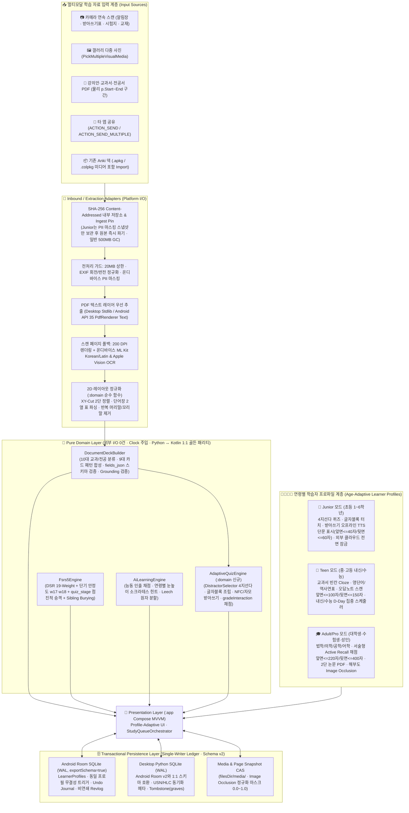

# 🏛️ Anki Studio 2.0 — 전 연령(초등~성인) 마스터 소프트웨어 설계도 & 전체 기능 정의서 (`v2.2 Final`)

- **문서 번호**: `ANKI-BLUEPRINT-2026-10-20` (**v2.2 Final All-Ages Universal Edition** — 초등 `Junior` · 중고등 `Teen` · 성인 `Adult` 통합 설계 · Claude Opus 5.5 + Codex GPT-6.1 Sol 검증본)
- **프로젝트 경로**: `/Users/choyoungseo/Documents/개발/Anki-Studio` (`src/anki_studio` + `android-app/`)
- **아키텍처 표준**: Clean / Hexagonal Architecture + MVVM + State Machine + ATDD/BDD/TDD/DDT
- **설계 목적**: **초등학교 저학년부터 중고등 수험생, 대학생·성인 전문가까지 모두 사용할 수 있는 범용 AI 암기·학습 플랫폼**을 단일 클린 아키텍처 코어로 구축하고, 구현 후 재작업(삽질)을 유발하는 **19대 아키텍처 함정(T1~T19)**을 사전 차단한다.

---

## 1. 시스템 전체 아키텍처 토폴로지 (All-Ages Clean / Hexagonal + Multi-Platform Parity)



---

## 2. 초등학생 ~ 성인 전 연령 대응 `ProfilePolicy` & `gradeInteraction` 결정론적 계약

코드 곳곳에 `if (age == "junior")` 분기를 두지 않고, 순수 함수 `resolveProfilePolicy(ageTier, profileOverrides, deckOverrides) -> ProfilePolicy`가 반환하는 **데이터 정책 객체(`ProfilePolicy`)**와 **단일 결정론적 채점 변환기(`gradeInteraction(InteractionResult, ProfilePolicy) -> GradeDecision`)**로 전 연령을 일관되게 처리합니다.

### 2.1 설정 우선순위 및 정본 텍스트 불변 계약 (Canonical vs Display Variants)
1. **설정 적용 우선순위 (Override Precedence)**:
   - **`Deck 명시적 설정 > LearnerProfile 사용자 설정 > AgeTier ProfilePolicy 기본값`** 순으로 적용합니다.
   - 단, **아동 보호 하드락(`junior`의 외부 클라우드 전송 차단 `cloud_vision_locked = 1`, `Easy(4)` 평점 차단)**은 상위 덱 설정으로도 해제할 수 없는 **불변 안전 게이트(Safety Invariant)**입니다.
2. **정본 텍스트(`notes.front/back`)와 연령별 표시 변형(`fields_json.display_variants`) 분리**:
   - `notes.front`와 `notes.back`에는 항상 **원문에서 추출·검증된 정본(Canonical) 텍스트**를 저장합니다.
   - 연령별 축약 질문이나 눈높이 해설은 `fields_json.display_variants` (`{"junior": {"front": "...", "back": "...", "explanation": "..."}, "teen": {...}, "adult": {...}}`)에 저장하며, 렌더링 시 **`display_variants[active_age_tier] ➔ 정본 notes.front/back`** 순으로 폴백합니다.
   - 모든 연령별 변형(`display_variants`)의 정답 토큰과 수치도 정본과 동일하게 `groundCards` 원문 대조 게이트를 통과해야 하며, **학습자가 초등(`junior`)에서 중고등(`teen`)·성인(`adult`)으로 프로필 등급을 올려도 기존 `notes.id`, `cards.id`, FSRS 기억 상태(`stability, difficulty, reps, lapses`)는 100% 그대로 유지**됩니다.

| 정책 항목 (`ProfilePolicy`) | 🌱 **Junior (초등 1~6학년)** | 🚀 **Teen (중·고등 내신/수능)** | 🎓 **Adult / Pro (대학생·수험·성인)** |
| :--- | :--- | :--- | :--- |
| **주요 입력 자료** | 받아쓰기 급수표, 초등 영단어장, 사회/과학 교과서, 단원평가 오답 시험지 | 중·고등 영어 본문/단어장, 국어 문법/문학, 역사 연표, 수학/과학 공식, 모의고사 오답 | 전공서·논문 PDF(2단), 법학 조문/판례, 의학 해부도, 공학 핸드북, 어학 회화, 자격증 기출 |
| **질문 / 정답 글자 수 게이트** | 앞면 **최대 40자**(권장 15~40자) / 뒷면 **최대 60자** (초과 시 문장 분할 또는 확인 대기열로 Fail-Closed) | 앞면 **최대 100자**(권장 30~100자) / 뒷면 **최대 150자** | 앞면 **최대 220자**(권장 50~220자) / 뒷면 **최대 400자** (조문·수식 원문 보존) |
| **일일 기본 상한 & 목표 기억률** | 신규 **10장** / 복습 **50장**, 목표 기억률 **`0.85`**, 정상 응답 기준시간 **`normalLatencyMs = 12,000ms`** | 신규 **20장** / 복습 **150장**, 목표 기억률 **`0.90`**, 정상 응답 기준시간 **`normalLatencyMs = 10,000ms`** | 신규 **25장** / 복습 **150장**, 목표 기억률 **`0.90`**, 정상 응답 기준시간 **`normalLatencyMs = 8,000ms`** |
| **허용 퀴즈 & 인출 방식** | `button_2`(`알아요/모르겠어요`), `multiple_choice`(4지선다), `tap_block`(글자블록), `dictation`(받아쓰기), `image_occlusion` *(자기평가 `Easy(4)` 전역 비활성화)* | 전체 모드 허용 (`multiple_choice`, `tap_block`, `dictation`, `cloze`, `free_recall`, `speaking`, `image_occlusion`, `button_4`) | 전체 모드 허용 (기본 `quiz_stage = 2` 직접 인출 우선: `free_recall`, `speaking`, `cloze`, `image_occlusion`, `button_4`) |
| **단계 승격 (`quiz_stage` Scaffolding)** | 카드별 `quiz_stage` (`0:RECOGNITION_MC ➔ 1:TAP_BLOCK ➔ 2:RECALL_INPUT`) 및 `consecutive_successes` 컬럼 운영:<br>• **승격 조건**: 첫 시도 성공(`rating >= 2`) 시 `consecutive_successes += 1`. **`stability >= 3.0` 이고 `consecutive_successes >= 2`** 달성 시 다음 복습부터 `quiz_stage = min(2, quiz_stage + 1)`로 승격 후 `consecutive_successes = 0` 리셋<br>• **강등 조건**: `AGAIN(1)` 발생 시 `consecutive_successes = 0` 리셋 및 `quiz_stage = max(0, quiz_stage - 1)`로 1단계 하향 | 좌동하되 **승격 기준 안정도 `stability >= 5.0` 이고 `consecutive_successes >= 2`** 달성 시 `quiz_stage` 승격 (`AGAIN(1)` 시 1단계 하향) | 기본 `quiz_stage = 2 (RECALL_INPUT)` 시작 (단, 거머리 카드나 사용자 선택 시 `0` 또는 `1` 단계 보조 사용 가능) |
| **아동 개인정보 & 하드락 안전 가드** | • 생년월일 미저장(`age_tier`만 저장)<br>• **외부 클라우드 비전/LLM/온라인 TTS·STT/공개 덱 공유 전면 하드락 OFF (`cloud_vision_locked = 1` DB CHECK 강제)**<br>• **수집 시 학교·학년·반·이름 PII 온디바이스 마스킹 후 원본 파일 즉시 파기(`local_cas_path = NULL`)** | 기본 온디바이스 처리 + 학생 실명/학번 정규식 마스킹 | 온디바이스 우선 + 선택적 외부 AI 연동 |

### 2.2 `gradeInteraction(InteractionResult, ProfilePolicy) -> Rating(1~4)` 결정론적 채점 명세
1. **첫 시도 전용 원칙 (First-Attempt-Only Rule)**:
   - 한 카드의 출제 턴에서 **첫 번째 제출(`attempt_count == 1`, `firstAttempt = true`)만 FSRS 평점(`1~4`) 및 `revlog` 스케줄링에 반영**됩니다. 오답 후 정답을 맞히기 위해 수행하는 동일 턴 내 재시도는 학습 피드백용일 뿐 FSRS 등급을 절대 상향하지 않습니다.
   - 응답 지연(`responseMs > policy.normalLatencyMs`)은 등급을 **1단계 하향(`4 ➔ 3` 또는 `3 ➔ 2`)만 할 수 있으며, 어떤 경우에도 등급을 상향하지 않습니다.**
2. **인터랙션 모드별 평점 변환 규칙**:
   - **`button_2` (2버튼 `알아요 / 모르겠어요`) [`evidence_class = 'recognition'`]**:
     - `모르겠어요` ➔ **`1 (Again)`**
     - `알아요` ➔ **`2 (Hard)`** *(검증 없는 2버튼 자기보고는 재인 수준이므로 `3(Good)`·`4(Easy)` 부여 금지)*
   - **`button_4` (4버튼 자기평가 `Again(1) / Hard(2) / Good(3) / Easy(4)`) [`evidence_class = 'recall'`]**:
     - 허용 대상: `Teen` 및 `Adult` 전용 (`Junior` 프로필에서는 비활성화되며 호출 시 Fail-Closed 거부)
     - 기본 평점: 사용자가 선택한 버튼 값(`selectedRating IN (1, 2, 3, 4)`)을 그대로 사용하되, **힌트를 사용한 경우(`hintUsed == true`) `4 (Easy)` 선택 시 `3 (Good)`으로 상한 클램프(`min(selectedRating, 3)`)**합니다. (명시적 4버튼 자기평가에서는 응답 시간 `responseMs`에 의한 강제 하향을 적용하지 않음)
   - **`multiple_choice` (객관식 선택) [`evidence_class = 'recognition'`]**:
     - 오답 선택 (`!isCorrect`) ➔ **`1 (Again)`**
     - 정답 선택 & `optionCount <= 3` (2~3지선다/OX) ➔ **`2 (Hard)` 상한 고정**
     - 정답 선택 & `optionCount >= 4` & (`hintUsed` 또는 `responseMs > policy.normalLatencyMs`) ➔ **`2 (Hard)`**
     - 정답 선택 & `optionCount >= 4` & `!hintUsed` & `responseMs <= policy.normalLatencyMs` ➔ **`3 (Good)`** *(객관식은 전 연령 `4(Easy)` 원천 차단)*
   - **`tap_block` (글자/단어 블록 터치 조립) [`evidence_class = 'cued_recall'`]**:
     - 최종 제출 전 블록 취소/교체 횟수를 `blockCorrections`로 계측:
     - 오답 제출 또는 `blockCorrections >= 2` ➔ **`1 (Again)`**
     - 정답 제출 & (`blockCorrections == 1` 또는 `hintUsed` 또는 `responseMs > policy.normalLatencyMs`) ➔ **`2 (Hard)`**
     - 정답 제출 & `blockCorrections == 0` & `!hintUsed` & `responseMs <= policy.normalLatencyMs` ➔ **`3 (Good)`** *(`4(Easy)` 차단)*
   - **`dictation` (TTS 받아쓰기 / 스펠링) [`evidence_class = 'recall'`]**:
     - 비교 전 **Unicode `NFC` 정규화** 및 **한글 초·중·종성 자모 분해 편집거리(`jamoEditDistance`)** 계산 (`fields_json.spacing_strict == true`이면 공백 불일치도 거리 `+1` 가산):
     - 받아쓰기 문장(`pattern == 'dictation_sentence'`): `jamoEditDistance == 0`이면 **`3 (Good)`** (`hintUsed` 또는 지연 시 **`2 (Hard)`**), `jamoEditDistance >= 1`이면 **`1 (Again)`**.
     - 일반 어휘 스펠링(`pattern == 'vocab_table'`): `jamoEditDistance == 0`이면 **`3 (Good)`**, `jamoEditDistance == 1`(단순 자모 오타 1자)이면 **`2 (Hard)`**, `jamoEditDistance >= 2`이면 **`1 (Again)`**.
   - **`free_recall` / `speaking` / `cloze` / `image_occlusion` (주관식 능동 인출) [`evidence_class = 'recall'`]**:
     - `evaluateFreeRecall` 종합 점수 `score = 0.65 * tokenOverlap + 0.35 * charBigram`:
     - 핵심 수치/단위 불일치(`!numericMatch`) 또는 부정어 충돌(`negationConflict == true`) 또는 `score < 45.0` ➔ **`1 (Again)`**
     - `45.0 <= score < 74.0` ➔ **`2 (Hard)`**
     - `74.0 <= score < 92.0` (또는 `score >= 92.0`이나 `hintUsed` / 응답 지연 / `age_tier == 'junior'`인 경우) ➔ **`3 (Good)`**
     - `score >= 92.0` & `!hintUsed` & `responseMs <= policy.normalLatencyMs` & `age_tier IN ('teen', 'adult')` ➔ **`4 (Easy)`**

---

## 3. 구현 후 '삽질(재작업)'을 유발하는 19대 아키텍처 함정과 선제 방어 설계 (T1 ~ T19)

기존 15대 기술 함정(T1~T15)에 더해, **초등~성인 전 연령 통합 설계 시 발생하는 4대 교육공학·시스템 함정(T16~T19)**을 추가 방어합니다.

| # | 재작업 위험 포인트 (Trap) | 현재 상태 및 위험 진단 | 선제 방어 설계 (Blueprint v2.2 Final Solution) |
| :-: | :--- | :--- | :--- |
| **T1** | **Room 마이그레이션 불가 및 스키마 확장성 부재** | `version = 1, exportSchema = false`, 노트가 `front/back` 고정 컬럼 | `exportSchema = true`, `room.schemaLocation` 지정, `MigrationTestHelper` 의무화, v1→v2 마이그레이션 시 기본 프로필(`profile_id = 1`) 선행 시드 후 전 테이블 확장 |
| **T2** | **카드 삭제 시 `revlog` 연쇄 삭제로 통계·FSRS 표본 증발** | `RevlogEntity`의 `onDelete = CASCADE`로 카드 삭제 시 과거 복습 기록도 삭제됨 | `revlog`에서 `CASCADE` 외래키를 제거하고 `profile_id`를 비연쇄 보존하여 카드가 삭제/분할되더라도 프로필별 장기 기억 데이터 영구 보존 |
| **T3** | **그룹 Undo 불가 · 편집 충돌 · 동기화 부활 버그** | 직전 상태 일부만 저장하며 형제 카드 Bury 복원 및 동기화 부활 방지 없음 | `undo_journal`에 변경 전 카드 스냅샷(`before_card_json`, `quiz_stage` 및 `consecutive_successes` 포함)과 최종 `after_modified_at_epoch_ms`를 기록, 불일치 시 Undo 차단, Undo 시 `graves`에 tombstone 기록 |
| **T4** | **신규 카드(`new`)에서 `Again` 선택 시 `lapses`가 증가하는 FSRS 버그** | `isNew && AGAIN`에서 `lapses += 1`이 되어 신규 카드를 2번 틀리면 Leech로 오판 | `lapses`는 오직 **`state == "review"`에서 `AGAIN`을 누른 경우에만 `+1` 증가**하도록 수정. 단기 안정도(`w17, w18`) 및 간격 Fuzz 반영 |
| **T5** | **하루 경계 시각(Day Rollover) 부재 및 큐(`queue`) 코드 불일치** | `dueEpochSec <= now` 하나로 모든 카드를 섞어 가져옴 | 새벽 4시(`rollover_hour = 4`) 기준 학습일(`studyDay`) 도입 및 7-State `queue`(`0:NEW, 1:INTRADAY, 2:REVIEW, 3:INTERDAY, -1:SUSPENDED, -2:USER_BURIED, -3:SIBLING_BURIED`) 전 계층 통일 |
| **T6** | **동일 문장 다중 빈칸(`c1`, `c2`) 및 역방향 카드 당일 스포일러** | 같은 노트의 카드들이 같은 날 연달아 출제되어 정답 노출 | **Sibling Burying (`queue = -3`, `buried_until_study_day = today + 1`)** 자동 적용 |
| **T7** | **모바일 카메라 촬영본 EXIF 회전 무시로 인한 한글 OCR 붕괴** | `BitmapFactory`가 EXIF 회전을 무시해 세로 사진이 90° 누운 채 OCR됨 | `ExifInterface` 회전/반전 정규화를 거친 정방향 비트맵만 OCR 및 Image Occlusion(0.0~1.0)에 사용 |
| **T8** | **2단(Two-Column) PDF 줄 섞임 및 디지털 PDF 무조건 OCR 병목** | 2단 문서 좌우 줄이 섞이며 디지털 PDF도 200 DPI OCR을 돌려 느림 | PDF 텍스트 레이어 우선 추출 + 실패 페이지만 200 DPI OCR 폴백 + `:domain` 순수 **2D XY-Cut 다단 정렬기** 탑재 |
| **T9** | **페이지 구간(`p.Start~End`) 선택 시 물리 페이지 번호 혼동** | `101~150쪽` 수집 시 `source_page`가 `1..50` 상대 번호로 저장될 위험 | `source_page`는 항상 **원본 PDF의 1-based 물리 페이지 번호(`101..150`)**로 고정하고 인쇄 쪽번호는 `page_label`로 분리 |
| **T10** | **프리뷰 취소 시 CAS 임시 파일 누수 및 대형 PDF 용량 폭발** | 프리뷰 취소 시 고아 파일이 남고 원본 PDF가 쌓여 용량 부족 유발 | `ingest_pins` 임시 핀 + 카드 참조 페이지 **WebP 경량 스냅샷(`~80KB/쪽`)** 보관 + 일반 프로필 원본 PDF 500MB LRU GC (`junior`는 추출 직후 원본 즉시 파기) |
| **T11** | **문서 개정/문구 수정 시 `guid` 변경으로 `UPDATED` 매칭 실패** | `guid`에 전체 앞면이 들어가 오타만 고쳐도 신규 카드로 중복 생성됨 | `semantic_guid`(노트 정체성)와 `content_hash = sha256(normalizedFront \|\| "\0" \|\| normalizedBack \|\| "\0" \|\| canonicalFieldsJson)` 분리 |
| **T12** | **희소 Cloze 번호(`c1, c3`) 및 빈칸 수정 시 자식 카드 고아/누락** | `1..k` 연속 가정 시 `c1, c3` 오작동 및 삭제된 `ord` 학습 이력 증발 | `distinctOrdinals(front)` 사용 + 유지된 `ord`는 FSRS 보존, 추가된 `ord`는 신규 생성, 제거된 `ord`는 `reps > 0`이면 `queue = -1(SUSPENDED)`로 보호 |
| **T13** | **Filtered / Cram 덱 사용 시 `deck_id` 직접 변경으로 인한 원복 실패** | 임시 덱 이동 중 강제 종료 시 원래 소속 덱 유실 | `cards.deck_id` 불변 유지 + `study_sessions(reschedule_enabled)` & `study_session_items` 가상 세션 테이블로 비파괴 운영 |
| **T14** | **백그라운드 프로세스 종료 시 대용량 OCR 작업 증발** | `viewModelScope` 코루틴이 앱 전환 시 종료됨 | `WorkManager` Foreground 체크포인트로 마지막 완료 페이지부터 이어서 수집 |
| **T15** | **Desktop(Python) ↔ Android(Kotlin) 도메인 이중 구현 괴리** | Python에만 AI 채점/힌트/Leech 분할이 있음 | `:domain`에 `AiLearningEngine.kt` & `AdaptiveQuizEngine.kt` 1:1 이식 및 공용 JSON 골든 벡터 검증 |
| **T16** | **[전 연령 신규] 재인(객관식) vs 회상(주관식) 점수 오염으로 인한 FSRS 안정도($S$) 뻥튀기** | 4지선다 보기를 보고 맞힌 것(재인)을 자유 회상과 똑같이 취급하거나 FSRS 가중치 최적화에 섞으면 복습 간격이 비정상적으로 길어져 대량 망각 발생 | **첫 시도 전용 채점 + 선택지 수(`optionCount`)별 등급 상한 + `evidence_class` 분리**:<br>① 첫 번째 제출(`attempt_count == 1`)만 FSRS 평점에 반영<br>② `button_2` 및 `optionCount <= 3` 객관식은 최대 `HARD(2)`, 4지선다는 최대 `GOOD(3)` 상한 고정(`EASY(4)` 원천 차단)<br>③ `revlog.evidence_class` (`'recognition' \| 'cued_recall' \| 'recall'`)를 기록하여 FSRS 최적화기(`w0~w18`)는 `evidence_class = 'recall'`(최소 1,000건)만 학습하며, 대시보드도 **'재인 익힘'**과 **'회상 익힘'**을 분리 표시 |
| **T17** | **[전 연령 신규] 4지선다 오답 보기(Distractor)를 통한 정답 유출 & 카드 수 부족(Cold-Start)** | 같은 노트의 역방향 짝 카드가 오답 보기로 나오거나 정답과 동일한 보기/중복 보기가 생성되며, 덱에 카드가 4장 미만일 때 4지선다 생성이 깨짐 | **`:domain` 순수 `DistractorSelector` 4단계 후보 탐색 & Anti-Leak 필터 & 결정론적 Cold-Start 폴백**:<br>① **후보 탐색 순서**: `wrong_answer_note`의 `student_wrong_answer` ➔ 같은 덱의 다른 노트(`note_id != current.note_id`, 형제/역방향 카드 제외) ➔ 동일 `profile_id`·동일 `category` 타 덱 카드 ➔ 수치/연도 근접 변형기 및 학년·과목별 내장 시드 오답 은행<br>② **Anti-Leak 필터 (전 후보 공통 강제)**: 학생 오답과 수치 변형 후보를 포함한 모든 후보는 `normalizedCandidate != normalizedAnswer`, 동의어(`synonyms`) 제외, 보기 간 중복 정규화 키 제거, 품사·단위 형태 일치 검사를 통과해야 하며 `review_id` 시드로 결정론적 셔플<br>③ **Cold-Start 결정론적 폴백**: 필터 통과 오답이 **3개 미만(`< 3`)**이면 동전 던지기식 2지선다나 가짜 보기를 만들지 않고 즉시 **`tap_block`(글자블록 조립) ➔ `button_2`(2버튼 모드)** 순으로 폴백 |
| **T18** | **[전 연령 신규] 학교 유인물(받아쓰기 급수표, 단어장 표, 단원평가 오답노트) 및 한글 NFC/NFD 인코딩 불일치** | macOS/iOS의 한글 NFD와 Android NFC가 달라 받아쓰기 채점이 틀리거나, 초·중·고 학교 프린트물 특유 양식이 추출되지 않음 | **한글 NFC 정규화 + 자모 단위 편집거리 + 10대 과목 · 9대 패턴(`fields_json` 버전 스키마) 확장**:<br>① 모든 받아쓰기/스펠링 비교 전 **Unicode NFC 통일** 및 한글 초·중·종성 자모 분해 편집거리 적용<br>② `wrong_answer_note`, `dictation_sentence`, `vocab_table`, `chronology_timeline` 등 **9대 패턴별 엄격한 `fields_json` 스키마(`schema_version: 1`)** 검증 및 불일치 시 Fail-Closed(`invalid_fields_schema`) |
| **T19** | **[전 연령 신규] 아동 개인정보(학교·반·이름) 노출 및 가족 공용 기기 프로필 데이터 혼선** | 초등학생 시험지/알림장 상단의 `OO초등학교 3학년 2반 홍길동` 텍스트가 카드나 원본 캐시에 남거나, 부모와 자녀의 덱/세션이 섞임 | **수집 즉시 온디바이스 PII 마스킹 & 원본 파기 + `junior` 하드락 + 프로필 간 교차 참조 차단 트리거**:<br>① `junior` 프로필은 DB `CHECK (age_tier != 'junior' OR cloud_vision_locked = 1)`로 외부 클라우드 비전/LLM/온라인 STT·TTS/공개 공유를 원천 차단<br>② `junior` 문서 수집 시 **저장 전** 이미지 내 학교·학년·반·이름 영역 마스킹 스냅샷만 생성하고 원본 파일은 즉시 삭제(`local_cas_path = NULL`)<br>③ `decks.parent_id`, `cards.deck_id ↔ notes.deck_id`, `study_session_items`에 **동일 `profile_id` 무결성 트리거(`cross_profile_violation`)** 강제 |

---

## 4. 전 연령 필수 기능 정의서 (Comprehensive Feature Matrix: FD-1 ~ FD-8)

### FD-1. 멀티모달 문서·사진 수집 & 학부모/교사 원클릭 스캐너 (Ingestion Pipeline)
- **FD-1.1 5대 입력 채널**:
  1. **카메라 문서 스캐너**: 초등 받아쓰기 급수표, 단원평가 시험지, 영어 단어장, 전공 교재를 연속 촬영 + 원근/기울기 자동 보정
  2. **갤러리 다중 사진 일괄 선택 (`PickMultipleVisualMedia`)**: 최대 20장 일괄 투입
  3. **PDF 문서 & 물리 페이지 구간 선택기 (`1 <= start <= end <= page_count`, 최대 50쪽 폭)**
  4. **시스템 멀티 공유 인텐트 (`ACTION_SEND` + `ACTION_SEND_MULTIPLE`)**: 카카오톡 알림장 사진, 굿노트/삼성노트 필기 PDF 즉시 공유
  5. **표준 `.apkg` / `.colpkg` 임포트**
- **FD-1.2 EXIF 회전 보정 · 온디바이스 PII 마스킹 · 2D XY-Cut 다단/표 정렬**:
  - 세로 촬영 사진 EXIF 회전 정규화 + 디지털 PDF 텍스트 우선 추출 + 스캔본 200 DPI 온디바이스 ML Kit/Vision OCR
  - **`junior` 프로필 PII 보호 수집 파이프라인**: OCR 텍스트와 페이지 이미지에서 학교명·학년·반·번·학생 실명 패턴(`*초등학교`, `*학년 *반`, `이름: ***`)을 온디바이스에서 먼저 마스킹한 뒤 `page_snapshots`와 `notes`를 생성하고, 마스킹 전 원본 파일(`filesDir/sources/<sha256>`)은 수집 완료 즉시 삭제(`local_cas_path = NULL`)합니다.
  - 2단 시험지/논문 XY-Cut 정렬 및 **영단어장/한자 표(좌우 2열 `단어 | 뜻`) 행 단위 짝맞춤 추출**

### FD-2. 연령 적응형 덱 합성 · `fields_json` 스키마 · Grounding 검증 (Age-Adaptive Deck Synthesis)
- **FD-2.1 10대 교과·전공 카테고리 자동 감지**:
  - **초·중·고 교과 (5종)**: `k12_korean`(국어·받아쓰기·한자), `k12_math`(수학·공식), `k12_social`(사회·한국사·세계사), `k12_science`(과학·실험), `language`(영어·외국어)
  - **대학·성인·전문 (5종)**: `law`(법학·행정), `medical`(의학·간호), `engineering`(공학·IT), `exam`(자격증·공무원·고시), `general`(일반교양)
- **FD-2.2 9대 학습 카드 패턴 및 `fields_json` (`schema_version: 1`) 필수 계약**:
  모든 노트의 `fields_json`은 공통 메타(`schema_version: 1`, 선택적 `display_variants`, `synonyms`)를 가지며, 패턴별 필수 키가 누락되거나 범위가 어긋나면 `BLOCKED (invalid_fields_schema)`로 Fail-Closed됩니다.
  1. `definition` (`용어: 설명`, `~란 ~이다`) ➔ 핵심 개념 Cloze / 객관식 (`{"schema_version": 1, "concept_key": "..."}`)
  2. `vocab_table` (`apple | 사과`, `고진감래 (苦盡甘來)`) ➔ 양방향 단어·한자 카드 (`ord=1` 뜻 맞히기, `ord=2` 단어/스펠링 맞히기; `{"schema_version": 1, "headword": "...", "meaning": "...", "pos": "noun|verb|...", "hanja": "..."}`)
  3. `dictation_sentence` (받아쓰기 급수표 번호 문장, 영어 듣기 문장) ➔ 오프라인 TTS 받아쓰기 / 글자블록 조립 카드 (`{"schema_version": 1, "grade_level": "초1_4급", "spacing_strict": true, "tts_locale": "ko-KR"}`)
  4. `chronology_timeline` (`1443년: 훈민정음 창제`, 시대순 사건) ➔ 연도·사건 양방향 Cloze 및 순서 블록 맞추기 (`{"schema_version": 1, "year_key": "1443", "era": "조선", "sequence_order": 1}`)
  5. `wrong_answer_note` (단원평가·모의고사 오답 시험지: 문항 + 학생 오답 + 정답/첨삭) ➔ 학생이 실제로 틀렸던 오답을 보존하는 맞춤형 오답노트 카드 (`{"schema_version": 1, "student_wrong_answer": "...", "error_type": "concept|calculation|careless", "correction_note": "..."}` — 단, `student_wrong_answer`도 정답/동의어와 겹치면 Anti-Leak 필터에서 자동 제외)
  6. `numbered_list` (`①②③`, `1) 2) 3)`) ➔ 항목 열거 Cloze (`{"schema_version": 1, "items": ["...", "..."]}`)
  7. `causal_compare` (`때문에`, `반면`, `vs`, `→`) ➔ 인과·비교 Q&A (`{"schema_version": 1, "relation": "cause_effect|contrast", "lhs": "...", "rhs": "..."}`)
  8. `statute_numeric` (`제N조`, 공식 `πr²`, 수치+단위 `3nm`, `120mmHg`) ➔ 조문·공식·수치 Cloze (`{"schema_version": 1, "numeric_values": ["3nm"], "unit": "nm"}`)
  9. `image_occlusion` (과학 실험 기구 명칭, 사회 지도, 의학 해부도, 공학 회로도) ➔ 정규화 좌표(`0.0~1.0`) 이미지 라벨 가리기 카드 (`{"schema_version": 1, "masks": [{"id": "m1", "ord": 1, "label": "우심실", "left": 0.12, "top": 0.34, "right": 0.28, "bottom": 0.45}]}` — 모든 좌표 `0.0 <= left < right <= 1.0`, `0.0 <= top < bottom <= 1.0` 필수)
- **FD-2.3 연령별 카드 문장 길이 가드 & 100% 원문 Grounding**:
  - 정본은 `notes.front/back`에 보존하고, `JUNIOR` 표시본은 앞면 **40자 이내** / 뒷면 **60자 이내**(`TEEN`은 **100자 / 150자**, `ADULT`는 **220자 / 400자**)로 구성하되, 정본과 모든 연령별 `display_variants`의 정답 토큰·수치는 반드시 `source_page` 원문에 존재해야 합니다(`groundCards` 통과 필수, 실패 시 임의 절단 대신 원자 분할 또는 확인 대기열 보류).

### FD-3. 전 연령 멀티모드 퀴즈 & 액티브 리콜 아레나 (`AdaptiveQuizEngine` + `AiLearningEngine`)
학습자의 연령(`age_tier`)과 카드의 인출 단계(`quiz_stage: 0=RECOGNITION_MC, 1=TAP_BLOCK, 2=RECALL_INPUT`)에 따라 4가지 인출 모드를 지원합니다:
1. **모드 A — 4지선다 객관식 퀴즈 (`multiple_choice` · `quiz_stage = 0`)**:
   - `:domain`의 `DistractorSelector`가 ① `wrong_answer_note`의 `student_wrong_answer` ➔ ② 같은 덱의 타 노트(`note_id != current.note_id`, 역방향 짝 카드 제외) ➔ ③ 동일 프로필·동일 카테고리 타 덱 ➔ ④ 수치/연도 근접 변형 및 학년·과목 시드 은행 순으로 오답 후보를 수집하고, **Anti-Leak 필터(정답·동의어·중복 제거)**를 통과한 유효 오답이 **3개 이상**일 때만 4지선다를 구성합니다.
   - **Cold-Start 폴백**: 유효 오답이 **3개 미만(`< 3`)**이면 즉시 **`tap_block`(글자블록 조립) ➔ `button_2`(2버튼 모드)**로 결정론적 폴백합니다.
2. **모드 B — 초성 & 글자/단어 블록 터치 조립 (`tap_block` · `quiz_stage = 1`)**:
   - 키보드 타이핑이 느린 초등학생도 섞여 있는 글자/단어 블록(`[훈]`, `[민]`, `[정]`, `[음]`, `[한]`, `[글]`)을 순서대로 터치해 정답을 조립하며, 제출 전 블록 수정 횟수(`blockCorrections`)를 계측해 정확도를 판정합니다.
3. **모드 C — TTS 듣고 받아쓰기 & 스피킹 구술 (`dictation` / `speaking` · `quiz_stage = 2`)**:
   - 문제는 가리고 온디바이스 TTS 음성만 들려준 뒤, 받아쓰기 타이핑하거나 마이크로 말하면(`STT`) Unicode NFC 정규화 및 한글 자모 편집거리로 철자·발음 정확도를 채점합니다.
4. **모드 D — 백지 서술형 Active Recall & 소크라테스 튜터 (`free_recall` / `cloze` / `image_occlusion` · `quiz_stage = 2`)**:
   - `evaluateFreeRecall`이 의미 토큰(65%) + 바이그램(35%) + 수치/단위 + 부정어 충돌을 채점해 0~100% 점수와 FSRS 등급을 산출합니다.
   - `generateSocraticHint(ageTier)`가 연령대에 맞는 말투와 2단계 단서(초성/글자수 ➔ 구조 마스킹/연상법)를 제공하며, `decomposeLeechCard`가 `lapses >= 2` 거머리 카드를 마이크로 카드로 원클릭 분할합니다.

### FD-4. FSRS-5 스케줄러 & 점진적 인출 승격 (FSRS-5 & Progressive Scaffolding)
- **FD-4.1 `gradeInteraction` 기반 객관식/주관식 차등 FSRS 매핑 & `quiz_stage` 승격**:
  - 섹션 2.2의 계약에 따라 첫 시도(`attempt_count == 1`)만 반영하며, `button_2` 및 `optionCount <= 3` 객관식은 최대 `Rating.HARD(2)`, 4지선다(`optionCount >= 4`)는 최대 `Rating.GOOD(3)`으로 상한을 고정합니다(`EASY(4)` 원천 차단).
  - **점진적 승격(Progressive Scaffolding)**:
    - `JUNIOR` 프로필: 첫 시도 정답(`rating >= 2`) 시 `consecutive_successes += 1`을 누적하며, **`stability >= 3.0` 이고 `consecutive_successes >= 2`** 달성 시 `quiz_stage`를 `0(객관식) ➔ 1(글자블록) ➔ 2(직접 인출/받아쓰기)`로 1단계 승격하고 `consecutive_successes = 0`으로 초기화합니다.
    - `TEEN` 프로필: **`stability >= 5.0` 이고 `consecutive_successes >= 2`** 달성 시 동일하게 `quiz_stage`를 1단계 승격합니다.
    - **강등(Step-Down)**: `Rating.AGAIN(1)` 발생 시 `consecutive_successes = 0`으로 리셋하고 `quiz_stage = max(0, quiz_stage - 1)`로 1단계 낮춰 다시 발판(Scaffolding)을 제공합니다.
- **FD-4.2 3-Queue 오케스트레이터 · Sibling Burying · Revision-Safe 그룹 Undo · D-Day 모드**:
  - 새벽 4시(`rollover_hour=4`) 학습일 기준 `Intraday ➔ Review/Interday ➔ New` 큐 운영, 형제 카드 당일 스포일러 방지, `quiz_stage`와 `consecutive_successes`까지 완벽 복원하는 그룹 트랜잭션 Undo, 방학/시험 후 밀린 복습 폭탄 평탄화(`Smart Backlog Decompressor`)를 지원합니다.

### FD-5 ~ FD-8. 원문 뷰어 · 비조작적 성취 피드백 · 멀티 프로필 · `.apkg` 호환
- **FD-5 (원문 페이지 스냅샷 뷰어 & 비파괴 오답노트 Cram 세션)**:
  - `📄 출처: 4학년_사회_교과서.pdf (p.32)` 클릭 시 해당 페이지 WebP 스냅샷과 발췌 문맥 즉시 팝업
  - 단원평가/시험 직전 `"이번 단원 틀린 문제만"` 비파괴 Cram 세션(`study_sessions`)으로 반복 연습
- **FD-6 (실측 기반 비조작적 성취 피드백 — Honest Mastery & Streak Feedback)**:
  - 불안감을 자극하는 손실 회피형 알림이나 가짜 퍼센트 표기를 배제하고, 실측 학습일 스트릭(🔥 Streak)과 **'재인 익힘(`quiz_stage < 2`)' / '회상 마스터(`quiz_stage == 2 && stability >= 21일`)' 분리 배지**로 정직한 성취감을 제공합니다.
- **FD-7 (가족/학급 멀티 프로필 & 아동 보호 모드)**:
  - `learner_profiles` 기반 프로필 격리 및 학부모/선생님이 만든 덱을 `.apkg` 파일로 자녀/학생 기기에 오프라인 1클릭 공유
- **FD-8 (`.apkg` 미디어 완전 호환 & Desktop↔Android 동기화)**

---

## 5. 정규화된 데이터베이스 스키마 v2 설계 (Room & Python SQLite 공통 정본)

### 5.1 v1 ➔ v2 무손실 마이그레이션 & 프로필 격리 불변식
1. **기본 프로필 선행 시드 (`Migration 1 -> 2`)**:
   - `v1` 데이터베이스를 `v2`로 마이그레이션할 때는 **반드시 1단계로 `learner_profiles` 테이블을 생성하고 기본 프로필(`profile_id = 1, sync_id = 'default-profile-v2', name = '기본 학습자', age_tier = 'adult', cloud_vision_locked = 0`)을 먼저 `INSERT`**한 뒤, `decks`와 `revlog`에 `profile_id INTEGER NOT NULL DEFAULT 1` 컬럼을 추가하여 기존 데이터가 외래키 오류 없이 100% 보존되도록 합니다.
2. **프로필 간 교차 참조 원천 차단 (`cross_profile_violation` SQLite Triggers)**:
   - 한 기기 내 여러 가족 구성원의 데이터가 섞이지 않도록, ① `decks.parent_id`가 가리키는 부모 덱의 `profile_id`는 자식 덱의 `profile_id`와 같아야 하고, ② `cards.deck_id`의 `profile_id`는 `notes.deck_id`의 `profile_id`와 같아야 하며, ③ `study_session_items.card_id`가 속한 덱의 `profile_id`는 `study_sessions.profile_id`와 같아야 합니다(위반 시 `RAISE(ABORT, 'cross_profile_violation')`).

```sql
-- 0. 학습자 프로필 (초등 Junior / 중고등 Teen / 성인 Adult 멀티 프로필 및 아동 보호 하드락 체크)
CREATE TABLE learner_profiles (
    profile_id INTEGER PRIMARY KEY AUTOINCREMENT,
    sync_id TEXT NOT NULL UNIQUE,
    name TEXT NOT NULL UNIQUE,                        -- 예: '기본 학습자', '민준(초등3)', '서연(고2)'
    age_tier TEXT NOT NULL DEFAULT 'adult'
        CHECK (age_tier IN ('junior', 'teen', 'adult')),
    avatar_emoji TEXT NOT NULL DEFAULT '🧠',
    preferred_quiz_mode TEXT NOT NULL DEFAULT 'auto'
        CHECK (preferred_quiz_mode IN ('auto', 'multiple_choice', 'tap_block', 'dictation', 'free_recall')),
    cloud_vision_locked INTEGER NOT NULL DEFAULT 1
        CHECK (age_tier != 'junior' OR cloud_vision_locked = 1), -- Junior는 무조건 1(외부 클라우드 전면 차단)
    daily_new_override INTEGER,                       -- NULL이면 AgeTier ProfilePolicy 기본값(10/20/25) 사용
    daily_review_override INTEGER,                    -- NULL이면 AgeTier ProfilePolicy 기본값(50/150/150) 사용
    streak_days INTEGER NOT NULL DEFAULT 0,
    last_study_day INTEGER,
    created_at_epoch_sec INTEGER NOT NULL
);

-- 1. 원본 문서 Content-Addressed 원장 (임시 URI 만료 방지 및 문서 계보/재수집 추적)
CREATE TABLE source_documents (
    doc_id INTEGER PRIMARY KEY AUTOINCREMENT,
    sha256_hash TEXT NOT NULL UNIQUE,                 -- 원본 파일 바이트 SHA-256
    doc_lineage_key TEXT NOT NULL,                    -- 문서 계열 식별자 (개정판 연결용, 기본: 정규화된 문서 제목)
    filename TEXT NOT NULL,
    mime_type TEXT NOT NULL,
    page_count INTEGER NOT NULL,
    local_cas_path TEXT,                              -- Junior 프로필 수집 시 추출 직후 즉시 파일 파기 및 NULL 처리; 일반은 500MB LRU GC
    pii_redacted INTEGER NOT NULL DEFAULT 0,          -- 1이면 온디바이스 학생 개인정보 마스킹 완료
    extractor_version INTEGER NOT NULL DEFAULT 1,
    imported_at_epoch_sec INTEGER NOT NULL
);

-- 2. 수집 작업 임시 Pin (프리뷰 중 GC 오삭제 방지 및 취소 시 고아 파일 정리)
CREATE TABLE ingest_pins (
    pin_id TEXT PRIMARY KEY,                          -- ingest_session_id
    sha256_hash TEXT NOT NULL,
    expires_at_epoch_sec INTEGER NOT NULL
);

-- 3. 미디어 & 페이지 스냅샷 Content-Addressed 저장소 (Image Occlusion · PII 마스킹된 페이지 WebP 캐시 · 오디오)
CREATE TABLE media_files (
    sha256_hash TEXT PRIMARY KEY,
    media_kind TEXT NOT NULL DEFAULT 'asset'
        CHECK (media_kind IN ('asset', 'page_snapshot', 'occlusion_base', 'tts_audio')),
    mime_type TEXT NOT NULL,
    local_path TEXT NOT NULL,                         -- filesDir/media/<sha256>
    byte_size INTEGER NOT NULL,
    last_accessed_epoch_sec INTEGER NOT NULL,
    created_at_epoch_sec INTEGER NOT NULL
);

-- 4. 덱 및 스케줄러 설정 (프로필 연결, 계층형 덱, 일일 한도 오버라이드, 학습일 경계 시각, 시험일 D-Day 포함)
CREATE TABLE decks (
    id INTEGER PRIMARY KEY AUTOINCREMENT,
    sync_id TEXT NOT NULL UNIQUE,
    profile_id INTEGER NOT NULL DEFAULT 1 REFERENCES learner_profiles(profile_id) ON DELETE CASCADE,
    parent_id INTEGER REFERENCES decks(id) ON DELETE SET NULL,
    name TEXT NOT NULL,                               -- 예: '초등3::국어::받아쓰기_4급', '의학::해부학::순환기'
    description TEXT NOT NULL DEFAULT '',
    category TEXT NOT NULL DEFAULT 'general'
        CHECK (category IN ('k12_korean', 'k12_math', 'k12_social', 'k12_science', 'language', 'law', 'medical', 'engineering', 'exam', 'general')),
    desired_retention REAL,                           -- NULL이면 ProfilePolicy 기본값(Junior 0.85 / Teen·Adult 0.90) 적용
    daily_new_limit INTEGER,                          -- NULL이면 LearnerProfile / ProfilePolicy 기본값 적용
    daily_review_limit INTEGER,                       -- NULL이면 LearnerProfile / ProfilePolicy 기본값 적용
    rollover_hour INTEGER NOT NULL DEFAULT 4,         -- 하루 경계 시각 (기본 04:00 AM)
    learning_steps_sec_json TEXT NOT NULL DEFAULT '[60, 600]',
    relearning_steps_sec_json TEXT NOT NULL DEFAULT '[600]',
    fsrs_weights_json TEXT,
    exam_target_study_day INTEGER,
    modified_at_epoch_ms INTEGER NOT NULL,
    created_at_epoch_sec INTEGER NOT NULL,
    UNIQUE(profile_id, name)
);

-- 5. 노트 (정본 front/back + fields_json 버전 스키마 + semantic_guid/content_hash 분리)
CREATE TABLE notes (
    id INTEGER PRIMARY KEY AUTOINCREMENT,
    guid TEXT NOT NULL UNIQUE,                        -- semantic_guid: sha256(deckId || noteType || pattern || anchorKey)[:16]
    content_hash TEXT NOT NULL,                       -- sha256(normalizedFront || "\0" || normalizedBack || "\0" || canonicalFieldsJson)
    deck_id INTEGER NOT NULL REFERENCES decks(id) ON DELETE CASCADE,
    doc_id INTEGER REFERENCES source_documents(doc_id) ON DELETE SET NULL,
    note_type TEXT NOT NULL
        CHECK (note_type IN ('basic', 'basic_reversed', 'cloze', 'speaking', 'dictation', 'image_occlusion')),
    pattern TEXT NOT NULL DEFAULT 'definition'
        CHECK (pattern IN ('definition', 'vocab_table', 'dictation_sentence', 'chronology_timeline', 'wrong_answer_note', 'numbered_list', 'causal_compare', 'statute_numeric', 'image_occlusion')),
    front TEXT NOT NULL,                              -- 원문 Grounded 정본(Canonical) 앞면 텍스트
    back TEXT NOT NULL,                               -- 원문 Grounded 정본(Canonical) 뒷면 텍스트
    fields_json TEXT NOT NULL DEFAULT '{"schema_version":1}', -- 패턴별 필수 키 + display_variants(junior/teen/adult) + masks
    extra_context TEXT NOT NULL DEFAULT '',
    tags_csv TEXT NOT NULL DEFAULT '',
    marked INTEGER NOT NULL DEFAULT 0,
    source_filename TEXT NOT NULL DEFAULT '',
    source_page INTEGER NOT NULL DEFAULT 1,           -- 항상 원본 문서의 1-based 물리 페이지 번호 (1..page_count)
    page_label TEXT,                                  -- 인쇄된 쪽번호 텍스트 (별도 보존)
    source_excerpt TEXT NOT NULL DEFAULT '',
    page_snapshot_sha256 TEXT REFERENCES media_files(sha256_hash) ON DELETE SET NULL,
    media_sha256 TEXT REFERENCES media_files(sha256_hash) ON DELETE SET NULL,
    modified_at_epoch_ms INTEGER NOT NULL,
    created_at_epoch_sec INTEGER NOT NULL
);

-- 6. 카드 (7-State Queue, quiz_stage 점진적 승격, consecutive_successes, Sibling/Manual Burying)
CREATE TABLE cards (
    id INTEGER PRIMARY KEY AUTOINCREMENT,
    sync_id TEXT NOT NULL UNIQUE,
    note_id INTEGER NOT NULL REFERENCES notes(id) ON DELETE CASCADE,
    deck_id INTEGER NOT NULL REFERENCES decks(id) ON DELETE CASCADE,
    ord INTEGER NOT NULL DEFAULT 1,
    state TEXT NOT NULL DEFAULT 'new'
        CHECK (state IN ('new', 'learning', 'review', 'relearning', 'suspended')),
    queue INTEGER NOT NULL DEFAULT 0
        CHECK (queue IN (0, 1, 2, 3, -1, -2, -3)),    -- 0:NEW, 1:INTRADAY, 2:REVIEW, 3:INTERDAY, -1:SUSPENDED, -2:USER_BURIED, -3:SIBLING_BURIED
    quiz_stage INTEGER NOT NULL DEFAULT 0
        CHECK (quiz_stage IN (0, 1, 2)),              -- 0:RECOGNITION_MC(객관식), 1:TAP_BLOCK(블록조립), 2:RECALL_INPUT(직접인출)
    consecutive_successes INTEGER NOT NULL DEFAULT 0, -- 현재 quiz_stage 내 연속 첫 시도 성공 횟수 (승격/Undo 대상)
    learning_step_index INTEGER NOT NULL DEFAULT 0,
    stability REAL NOT NULL DEFAULT 0.0,
    difficulty REAL NOT NULL DEFAULT 0.0,
    due_epoch_sec INTEGER NOT NULL,
    due_study_day INTEGER NOT NULL DEFAULT 0,
    last_review_epoch_sec INTEGER,
    buried_until_study_day INTEGER,
    reps INTEGER NOT NULL DEFAULT 0,
    lapses INTEGER NOT NULL DEFAULT 0,
    scheduled_days REAL NOT NULL DEFAULT 0.0,
    flags INTEGER NOT NULL DEFAULT 0,
    modified_at_epoch_ms INTEGER NOT NULL,
    UNIQUE(note_id, ord)
);

-- 7. 복습 이력 (Non-Cascading 영구 보존 + 프로필 귀속 + 인터랙션/증거 등급 분리)
CREATE TABLE revlog (
    id INTEGER PRIMARY KEY AUTOINCREMENT,
    sync_id TEXT NOT NULL UNIQUE,
    undo_group_id TEXT NOT NULL,
    profile_id INTEGER NOT NULL DEFAULT 1,            -- FK CASCADE 없음! (프로필별 학습 통계/FSRS 표본 영구 보존)
    card_id INTEGER NOT NULL,                         -- FK CASCADE 없음! (카드 삭제 후에도 이력 보존)
    deck_id INTEGER NOT NULL,
    review_type TEXT NOT NULL DEFAULT 'normal'
        CHECK (review_type IN ('normal', 'cram', 'reschedule')),
    interaction_mode TEXT NOT NULL DEFAULT 'button_4'
        CHECK (interaction_mode IN ('button_2', 'button_4', 'multiple_choice', 'tap_block', 'dictation', 'free_recall', 'speaking', 'cloze', 'image_occlusion')),
    evidence_class TEXT NOT NULL DEFAULT 'recall'
        CHECK (evidence_class IN ('recognition', 'cued_recall', 'recall')), -- FSRS 가중치 최적화는 'recall'만 사용
    attempt_count INTEGER NOT NULL DEFAULT 1,         -- 1(첫 시도)만 FSRS 스케줄링에 반영
    hint_used INTEGER NOT NULL DEFAULT 0,             -- 0 | 1
    option_count INTEGER,                             -- 객관식일 때 보기 개수 (예: 4)
    policy_version INTEGER NOT NULL DEFAULT 1,        -- 채점 정책 버전
    rating INTEGER NOT NULL CHECK (rating BETWEEN 1 AND 4),
    prev_state TEXT NOT NULL,
    next_state TEXT NOT NULL,
    prev_queue INTEGER NOT NULL,
    next_queue INTEGER NOT NULL,
    prev_quiz_stage INTEGER NOT NULL DEFAULT 0,
    next_quiz_stage INTEGER NOT NULL DEFAULT 0,
    prev_stability REAL NOT NULL,
    next_stability REAL NOT NULL,
    prev_difficulty REAL NOT NULL,
    next_difficulty REAL NOT NULL,
    prev_due_epoch_sec INTEGER NOT NULL,
    prev_due_study_day INTEGER NOT NULL,
    prev_last_review_epoch_sec INTEGER,
    prev_reps INTEGER NOT NULL,
    prev_lapses INTEGER NOT NULL,
    prev_scheduled_days REAL NOT NULL,
    scheduled_days REAL NOT NULL,
    elapsed_days REAL NOT NULL,
    retrievability REAL NOT NULL DEFAULT 1.0,
    review_duration_ms INTEGER NOT NULL DEFAULT 0,
    user_typed_answer TEXT,
    ai_eval_score_pct REAL,
    reviewed_at_epoch_sec INTEGER NOT NULL
);

-- 8. 그룹 Undo 저널 (before_card_json에 quiz_stage, consecutive_successes 포함)
CREATE TABLE undo_journal (
    id INTEGER PRIMARY KEY AUTOINCREMENT,
    undo_group_id TEXT NOT NULL,
    session_id TEXT NOT NULL,
    card_id INTEGER NOT NULL,
    before_card_json TEXT NOT NULL,
    after_modified_at_epoch_ms INTEGER NOT NULL,
    created_at_epoch_sec INTEGER NOT NULL
);

-- 9. 비파괴 Filtered / Cram 커스텀 학습 세션
CREATE TABLE study_sessions (
    session_id TEXT PRIMARY KEY,
    profile_id INTEGER NOT NULL DEFAULT 1 REFERENCES learner_profiles(profile_id) ON DELETE CASCADE,
    name TEXT NOT NULL,
    filter_query TEXT NOT NULL,
    reschedule_enabled INTEGER NOT NULL DEFAULT 0,
    created_at_epoch_sec INTEGER NOT NULL
);

CREATE TABLE study_session_items (
    session_id TEXT NOT NULL REFERENCES study_sessions(session_id) ON DELETE CASCADE,
    card_id INTEGER NOT NULL REFERENCES cards(id) ON DELETE CASCADE,
    position INTEGER NOT NULL,
    completed INTEGER NOT NULL DEFAULT 0,
    PRIMARY KEY (session_id, card_id)
);

-- 10. 삭제 Tombstone
CREATE TABLE graves (
    id INTEGER PRIMARY KEY AUTOINCREMENT,
    entity_type TEXT NOT NULL,
    sync_id TEXT NOT NULL,
    deleted_at_epoch_ms INTEGER NOT NULL,
    UNIQUE(entity_type, sync_id)
);

-- 11. 프로필 격리 불변식 트리거 (Cross-Profile Isolation Guards — INSERT & UPDATE 전 경로 방어)
CREATE TRIGGER trg_decks_profile_immutable
BEFORE UPDATE OF profile_id ON decks
WHEN NEW.profile_id != OLD.profile_id
BEGIN
    SELECT RAISE(ABORT, 'cross_profile_violation: deck profile_id is immutable');
END;

CREATE TRIGGER trg_decks_same_profile_insert
BEFORE INSERT ON decks
WHEN NEW.parent_id IS NOT NULL AND (SELECT profile_id FROM decks WHERE id = NEW.parent_id) != NEW.profile_id
BEGIN
    SELECT RAISE(ABORT, 'cross_profile_violation: parent deck profile_id mismatch');
END;

CREATE TRIGGER trg_decks_same_profile_update
BEFORE UPDATE OF parent_id ON decks
WHEN NEW.parent_id IS NOT NULL AND (SELECT profile_id FROM decks WHERE id = NEW.parent_id) != NEW.profile_id
BEGIN
    SELECT RAISE(ABORT, 'cross_profile_violation: parent deck profile_id mismatch');
END;

CREATE TRIGGER trg_notes_same_profile_update
BEFORE UPDATE OF deck_id ON notes
WHEN (SELECT profile_id FROM decks WHERE id = NEW.deck_id) != (SELECT profile_id FROM decks WHERE id = OLD.deck_id)
  OR EXISTS (
      SELECT 1 FROM cards c JOIN decks d ON c.deck_id = d.id
      WHERE c.note_id = NEW.id AND d.profile_id != (SELECT profile_id FROM decks WHERE id = NEW.deck_id)
  )
BEGIN
    SELECT RAISE(ABORT, 'cross_profile_violation: note deck profile_id mismatch');
END;

CREATE TRIGGER trg_cards_same_profile_insert
BEFORE INSERT ON cards
WHEN (SELECT profile_id FROM decks WHERE id = NEW.deck_id) != (SELECT d.profile_id FROM notes n JOIN decks d ON n.deck_id = d.id WHERE n.id = NEW.note_id)
BEGIN
    SELECT RAISE(ABORT, 'cross_profile_violation: card deck and note deck profile_id mismatch');
END;

CREATE TRIGGER trg_cards_same_profile_update
BEFORE UPDATE OF deck_id, note_id ON cards
WHEN (SELECT profile_id FROM decks WHERE id = NEW.deck_id) != (SELECT d.profile_id FROM notes n JOIN decks d ON n.deck_id = d.id WHERE n.id = NEW.note_id)
  OR EXISTS (
      SELECT 1 FROM study_session_items ssi JOIN study_sessions ss ON ssi.session_id = ss.session_id
      WHERE ssi.card_id = NEW.id AND ss.profile_id != (SELECT profile_id FROM decks WHERE id = NEW.deck_id)
  )
BEGIN
    SELECT RAISE(ABORT, 'cross_profile_violation: card deck, note deck, or session profile_id mismatch');
END;

CREATE TRIGGER trg_study_sessions_profile_immutable
BEFORE UPDATE OF profile_id ON study_sessions
WHEN NEW.profile_id != OLD.profile_id
BEGIN
    SELECT RAISE(ABORT, 'cross_profile_violation: study_session profile_id is immutable');
END;

CREATE TRIGGER trg_session_items_same_profile_insert
BEFORE INSERT ON study_session_items
WHEN (SELECT profile_id FROM study_sessions WHERE session_id = NEW.session_id) != (SELECT d.profile_id FROM cards c JOIN decks d ON c.deck_id = d.id WHERE c.id = NEW.card_id)
BEGIN
    SELECT RAISE(ABORT, 'cross_profile_violation: session and card profile_id mismatch');
END;

CREATE TRIGGER trg_session_items_same_profile_update
BEFORE UPDATE OF session_id, card_id ON study_session_items
WHEN (SELECT profile_id FROM study_sessions WHERE session_id = NEW.session_id) != (SELECT d.profile_id FROM cards c JOIN decks d ON c.deck_id = d.id WHERE c.id = NEW.card_id)
BEGIN
    SELECT RAISE(ABORT, 'cross_profile_violation: session and card profile_id mismatch');
END;
```

---

## 6. 단계별 구현 로드맵 (Zero-Rework Engineering Roadmap: P0 ~ P6)

| 단계 | 목표 모듈 | 핵심 작업 내역 | 완료 기준 (ATDD Verification Gate) | 상태 |
| :-: | :--- | :--- | :--- | :-: |
| **Base** | **Foundation & CLI/IDE 빌드 체계** | Python 서버/데스크톱 + Android `:domain` (`Fsrs5Engine`, `DocumentDeckBuilder`) + Gradle 8.9 Wrapper + APK 빌드 + Android Studio | Python `54 passed`, Mutation `12/12 killed`, Android `:domain:test` & `:app:assembleDebug` 성공 | ✅ **완료** (`3387f9b`) |
| **P0** | **스키마 v2 고정 & `:domain` 전 연령 AI/퀴즈 코어 패리티** | ① Room & Python SQLite 스키마 v2 통일 (`learner_profiles` 기본 시드, 동일 프로필 트리거, `source_documents`, `ingest_pins`, `media_files`, `undo_journal`, `study_sessions`, `graves`, `exportSchema=true`, `Clock` 주입)<br>② `:domain`에 `AiLearningEngine.kt` + **`AdaptiveQuizEngine.kt` (`ProfilePolicy`, `DistractorSelector`, 글자블록 조립기, NFC/자모 받아쓰기 채점기, `gradeInteraction`)** 1:1 이식 | `MigrationTestHelper` v1→v2 무손실 통과 + `cross_profile_violation` 차단 검증 + Python↔Kotlin 골든 벡터 100% 일치 | 🔜 **1순위 착수 대상** |
| **P1** | **FSRS-5 정밀 스케줄러 & `quiz_stage` 점진적 승격 & 그룹 Undo** | ① `isNew` Lapse 버그 수정, 단기 안정도(`w17, w18`), `gradeInteraction` 차등 매핑, **`stability >= 3.0(Junior)/5.0(Teen) & consecutive_successes >= 2` 기반 `quiz_stage` 승격/강등**<br>② 하루 경계(`rolloverHour=4`), 3-Queue 일일 한도, Sibling Burying<br>③ Revision 검증형 그룹 트랜잭션 `Undo` (`quiz_stage`, `consecutive_successes` 복원 포함) | DDT: `04:00` 경계 테스트, 객관식 정답 시 `EASY` 차단 검증, Undo 전후 대상 카드 그룹(`cards` 전 컬럼) 100% 일치 및 `revlog` 롤백·`graves` Tombstone·`undo_journal` 소진 검증 | 📋 예정 |
| **P2** | **초·중·고~성인 문서/표 비전 파이프라인 & 아동 PII 보호 하드닝** | ① EXIF 회전/반전 자동 정규화 & **`JUNIOR` 온디바이스 PII 마스킹 후 원본 즉시 삭제(`local_cas_path=NULL`)**<br>② PDF 텍스트 레이어 우선 추출 + 스캔 페이지 200 DPI OCR 폴백<br>③ `:domain` 2D XY-Cut 다단 정렬 + **10대 교과/전공 분류 · 9대 카드 패턴(`fields_json` 스키마 v1) 확장**<br>④ 물리 페이지 구간 선택, 다중 사진 선택, `WorkManager` 체크포인트 | 초등 받아쓰기표·중등 영단어 표·단원평가 오답노트·성인 2단 법전 골든 픽스처 추출 정확도 ≥ 98%, PII 노출 0건 | 📋 예정 |
| **P3** | **SHA-256 CAS 멱등 재수집 & Cloze 재조정 & 원문 뷰어** | ① 수집 파일 내부 CAS(`ingest_pins` + 페이지 WebP 스냅샷 캐시 + 500MB GC)<br>② `semantic_guid` + `content_hash` 기반 스마트 Upsert 및 Cloze `distinctOrdinals` 재조정<br>③ 복습 중 `출처 p.N` 클릭 시 물리 페이지 스냅샷 모달 | 동일/개정 파일 재투입 시 기존 카드 `stability` 보존, Cloze 수정 시 기존 ordinal 이력 보존 | 📋 예정 |
| **P4** | **전 연령 퀴즈 UI (객관식·블록·받아쓰기·Image Occlusion)** | ① 프로필 전환바(`🌱초등 / 🚀중고등 / 🎓성인`) & 4지선다 객관식 / 글자블록 터치 / 오프라인 TTS 받아쓰기 / 서술형 채점 UI<br>② **Image Occlusion** 편집기/렌더러 (과학 실험기구·사회 지도·의학 해부도)<br>③ 실측 스트릭(🔥) & 재인/회상 분리 마스터 배지 UI | 초등 모드(객관식/블록/TTS) 및 성인 모드(서술형/IO) UI E2E 검증 | 📋 예정 |
| **P5** | **`.apkg` 학부모/교사 덱 공유 & 동기화/백업** | ① 미디어 포함 `.apkg` Import/Export (부모님/선생님이 만든 덱을 자녀 기기로 공유)<br>② Android `dataExtractionRules` 안전 백업 + Desktop↔Android 증분 동기화 | 외부/가족 간 `.apkg` 덱 공유 왕복 무손실 | 📋 예정 |
| **P6** | **개인화 FSRS 가중치 최적화 & 비파괴 오답 Cram 세션** | ① 누적 `revlog` 중 **`evidence_class = 'recall'` (최소 1,000건)** 기반 온디바이스 FSRS `w0~w18` 최적화기<br>② 단원평가/시험 D-Day 스케줄러 & `study_sessions` 비파괴 오답노트 Cram 덱 | 표본 부족 시 Fail-Closed 동작 확인, Cram 세션 종료 시 원본 카드 `deck_id` 불변 검증 | 📋 예정 |

---

## 7. 멀티모델 설계 리뷰 & 보완 이력 (Review Evolution Log)

- **v1.0 ~ v1.3**: 성인/전공 학습 기준 15대 아키텍처 함정(T1~T15) 방어 및 스키마 v2 정합성 확립 (Claude Opus 5.5 + Codex GPT-6.1 Sol `NO_FINDINGS` 통과).
- **v2.0 ~ v2.2 Final (초등학교 ~ 성인 전 연령 통합 확장 — All-Ages Universal Edition)**:
  1. **[3-Tier 연령별 `ProfilePolicy` & 정본/표시 분리 (`display_variants`)]** 코드 분기 없이 `ProfilePolicy` 데이터 객체(Junior `40/60자, 10/50장, 0.85, 12s`, Teen `100/150자, 20/150장, 0.90, 10s`, Adult `220/400자, 25/150장, 0.90, 8s`)와 설정 우선순위(`Deck > Profile > AgeTier`)로 동작하며, 정본(`notes.front/back`)과 연령별 표시본(`fields_json.display_variants`)을 분리해 진급 시에도 FSRS 학습 이력을 100% 승계.
  2. **[결정론적 `gradeInteraction` & `quiz_stage` 점진적 승격 (T16, T17)]** 첫 시도 전용 채점, `button_2` 및 `optionCount <= 3` `Hard(2)` 상한, 4지선다 `Good(3)` 상한, `tap_block` 수정 횟수(`blockCorrections`) 반영, `stability >= 3.0(Junior)/5.0(Teen) & consecutive_successes >= 2` 기반 `quiz_stage (0 ➔ 1 ➔ 2)` 승격/강등, 유효 오답 3개 미만 시 `tap_block ➔ button_2` 결정론적 폴백 명문화.
  3. **[10대 교과/전공 분류 & 9대 카드 패턴 `fields_json` 버전 스키마 (T18)]** 한글 Unicode NFC 통일 + 자모 편집거리 받아쓰기 채점, 단원평가 오답노트(`wrong_answer_note`)·받아쓰기(`dictation_sentence`)·단어장 표(`vocab_table`)·역사 연표(`chronology_timeline`) 등 9대 패턴의 `schema_version: 1` 필수 필드 계약 확립.
  4. **[아동 개인정보 하드락 & 멀티 프로필 DB 격리 트리거 (T19)]** `junior` 프로필의 클라우드 전송 차단 `CHECK` 제약, 수집 시 온디바이스 PII 마스킹 후 원본 파일 즉시 파기(`local_cas_path = NULL`), v1→v2 기본 프로필 시드 및 프로필 간 교차 참조 차단 SQLite 트리거(`cross_profile_violation`) 완비.
